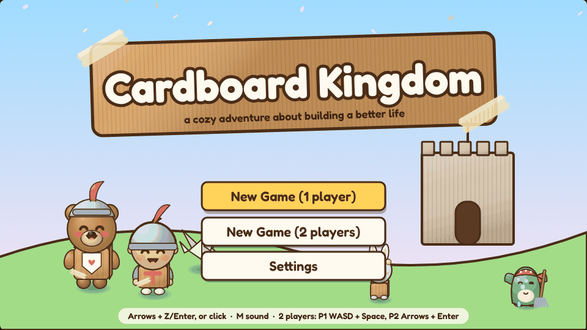
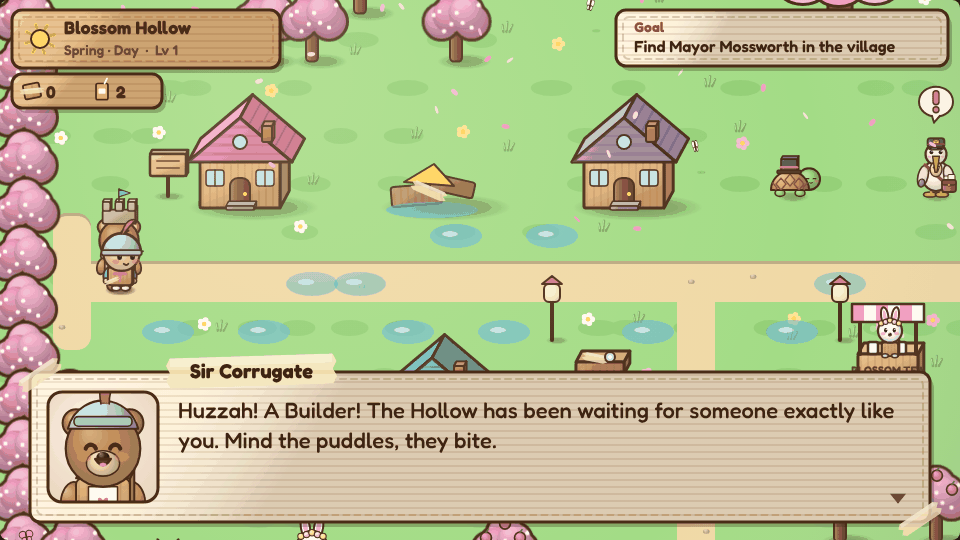
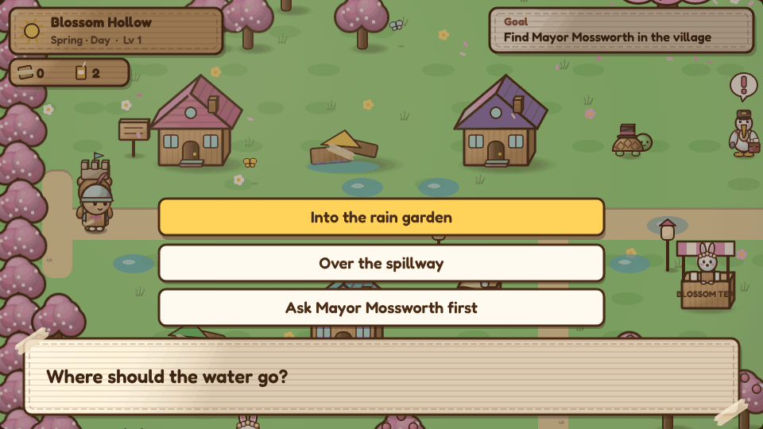
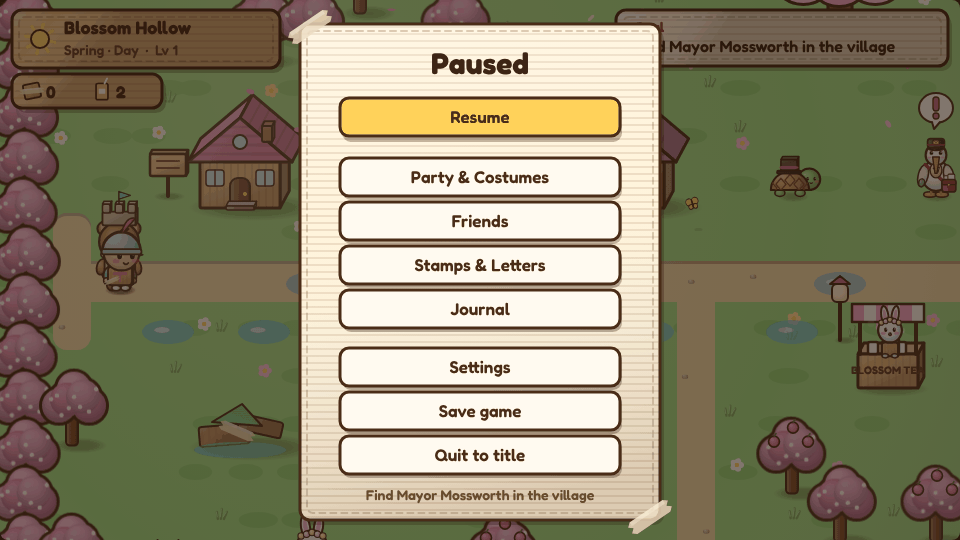
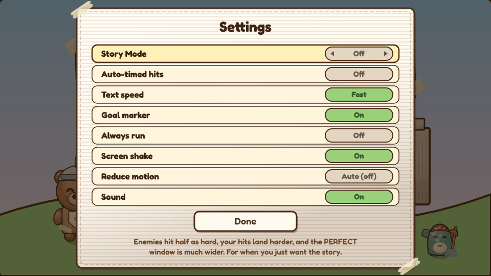
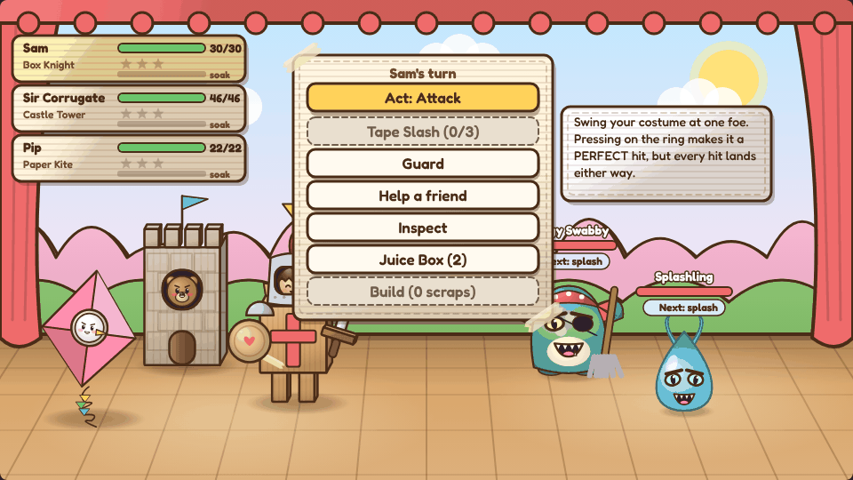
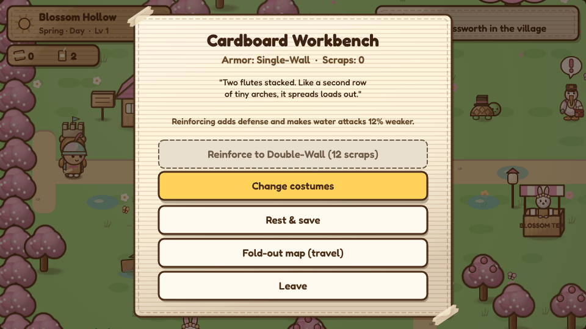
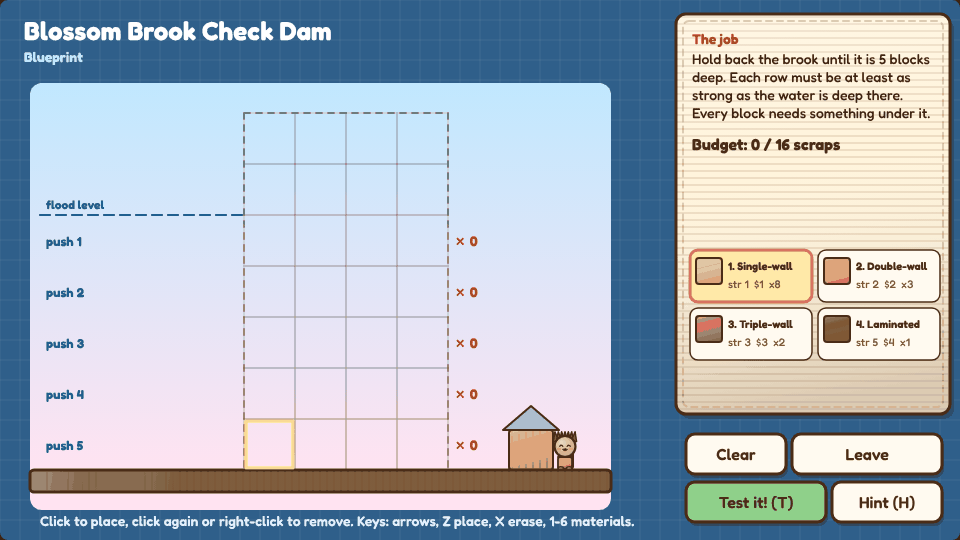

<div align="center">

# Cardboard Kingdom

**A cozy adventure about a burnt-out civil engineering student, a fridge box that turns out to be a door, and a kingdom made of cardboard that needs an engineer.**

[Play it in your browser](https://normansrule.github.io/cardboard-kingdom/) · [Download](https://github.com/Normansrule/cardboard-kingdom/releases/latest) · [Changelog](CHANGELOG.md) · [The story](docs/STORY.md)


</div>

## What it is

Cardboard Kingdom is a short, wholesome role-playing game in the spirit of Costume Quest. You play Sam, a college student who has stopped enjoying their civil engineering degree, until a glowing fridge box drops them into a kingdom of cardboard animals whose homes keep washing away. You explore four seasons of villages, turn homemade costumes into giant battle forms, and fix each place by actually engineering something (dams, flood gates, bridges, rain gardens) with puzzles where the water is simulated, so you watch your design hold or fail. It's made for anyone who likes cozy games, from kids playing with a parent to adults who need a gentle reminder of why they liked building things. It runs in any browser, alone or with a friend on the same keyboard, with nothing to install.

## Key features

- **Costume Quest-style battles.** Act, Guard, Help and Inspect, plus a Special for each of 12 costumes. Timed button presses make a hit stronger but never decide whether it lands.
- **Engineering puzzles with a Test button.** 13 of them, from a check dam to live water valves. Build, test, watch the water, revise. Grandma's Blueprint is there if you're stuck.
- **A full story.** A prologue, 14 chapters and an epilogue, with twists that are kinder than you'd expect. ([Spoilers here.](docs/STORY.md))
- **All four seasons, day and night.** Cherry blossoms in spring, beaches in summer, falling leaves in autumn, snow in winter. Days are bright and cute; nights are darker and cozy.
- **Two-player co-op** on one keyboard. Player 2 is Jules, with real turns in battle.
- **Repairs that stay fixed.** Neighbors thank you, postcards show places before and after, and one street gets its colour back.
- **Cozy extras.** Fishing (14 kinds), fruit trees to shake, the Kingdom Post, Patchwork Hall, and Rivet, a bottle-cap beetle who digs up buttons.
- **Easy Play settings.** Story Mode, auto-timed hits, a goal marker, text speed, always run, and a Reduce motion switch that follows your computer's own setting.
- **No dependencies.** A custom engine in plain JavaScript on an HTML (HyperText Markup Language) canvas. Every sprite is drawn in code, so the whole download is about 700 KB (kilobytes).

## Screenshots

The interface after the 2.16 design pass:

| Title | Dialogue | A choice |
|---|---|---|
|  |  |  |
| **Pause menu** | **Settings** | **Battle** |
|  |  |  |
| **Workbench** | **Puzzle** | |
|  |  | |

And every place in the game, recorded from the current build:

<table>
<tr>
<td align="center" width="33%"><br><b>Riverside University</b><br><sub>The real world: grey until Sam finds their way back.</sub></td>
<td align="center" width="33%"><br><b>Ch. 1 · Blossom Hollow</b> (spring)<br><sub>Cherry blossoms and a cardboard dam.</sub></td>
<td align="center" width="33%"><br><b>Ch. 2 · Sunpatch Shores</b> (summer)<br><sub>Beaches and flood gates.</sub></td>
</tr>
<tr>
<td align="center"><br><b>Ch. 3 · Amberleaf Woods</b> (autumn)<br><sub>Falling leaves and a truss bridge.</sub></td>
<td align="center"><br><b>Ch. 4 · Frostfold Peak</b> (winter)<br><sub>Snow and Grandma's Summit Dam.</sub></td>
<td align="center"><br><b>Ch. 7 · Riverbend</b><br><sub>Grandma's cottage and a stone arch.</sub></td>
</tr>
<tr>
<td align="center"><br><b>Ch. 8 · Lanternmere</b><br><sub>Light the path, not the sky.</sub></td>
<td align="center"><br><b>Ch. 9 · Gull Point</b><br><sub>A leaning lighthouse and a living shoreline.</sub></td>
<td align="center"><br><b>Ch. 10 · The Long Bridge</b><br><sub>Kites and a suspension bridge.</sub></td>
</tr>
<tr>
<td align="center"><br><b>Patchwork Hall</b> (the hub)<br><sub>The Postcard Wall and the Costume Parade.</sub></td>
<td align="center"><br><b>Ch. 11 · The Ferryyard</b><br><sub>A ramp everyone can use.</sub></td>
<td align="center"><br><b>Ch. 12 · Reedwhistle Marsh</b><br><sub>Fishing and putting the bends back in a brook.</sub></td>
</tr>
<tr>
<td align="center"><br><b>Ch. 14 · Thimble Row</b><br><sub>Giant teacups, live valves, a festival.</sub></td>
<td align="center"><br><b>Battles</b><br><sub>Everyday costumes become giant battle forms.</sub></td>
<td align="center"><br><b>Rivet</b><br><sub>A companion who digs up buried buttons.</sub></td>
</tr>
</table>

The engineering puzzles in motion:

| Spillway (Ch. 4) | Festival lights (Ch. 8) | Accessible ramp (Ch. 11) |
|---|---|---|
|  |  |  |
| **Give the bends back (Ch. 12)** | **The model bridge (Ch. 13)** | **Live valves and the colour bloom (Ch. 14)** |
|  |  |  |

More pictures: the [cast](docs/media/cast.png), the [costumes](docs/media/costumes.png), the [full reference set](docs/media/current/README.md) of every place, boss and puzzle, and [how each version was built](docs/media/process/README.md).

## Where it's at


<details>
<summary><b>The checklist behind the bars</b></summary>

| Area | Status | Notes |
|---|---|---|
| Main story: prologue, Chapters 1 to 14, epilogue | Done | All playable start to finish, solo or two-player co-op. |
| Four seasons, day and night | Done | Spring, summer, autumn and winter chapters, each with a night version. |
| Costume Quest battles (Act, Guard, Help, Inspect, Specials) | Done | 12 costumes, each with a battle form; timing helps but never gates. |
| Engineering puzzles with a Test button | Done | 13 puzzles, from dams to live valves; Grandma's Blueprint if you're stuck. |
| Repairs stay visible | Done | Postcards before/after, the Neighbor Round, the Thimble Row colour bloom. |
| Easy Play (Story Mode, goal marker, text speed, Reduce motion) | Done | |
| Cozy extras: fishing, fruit trees, the Post, Patchwork Hall | Done | |
| Companions who follow you | 1 of 3 | Rivet (2.15). Two more planned. |
| Walk-in interiors | Some | Patchwork Hall, the engineering studio, inside the Teapot. Houses are knock-and-talk. |
| Destinations from the design direction | 2 of 16 | The Ferryyard and Reedwhistle Marsh so far. |
| Atlas prototypes (festival neighborhood, a place that improves, three-room puzzle) | Done | Thimble Row covers all three. |
| Atlas prototypes (delivery kart, giant repair machine) | Planned | |
| Toon-shaded 3D renderer | Not planned | The game is a 2.5D canvas engine on purpose. |

</details>

## Setup and usage

**Play online:** [normansrule.github.io/cardboard-kingdom](https://normansrule.github.io/cardboard-kingdom/). Your progress saves in the browser.

**Play offline:**
1. Download `cardboard-kingdom-<version>.zip` from the [latest release](https://github.com/Normansrule/cardboard-kingdom/releases/latest) and unzip it.
2. Double-click the launcher for your computer: `play.bat` on Windows, `play.command` on macOS (the first time, right-click it and choose **Open**), or `play.sh` on Linux.
3. Or just open `cardboard-kingdom-single-file.html` in any browser. That one file is the whole game.

**Run from source:** clone the repo and open `index.html`. There's no build step. If your browser is fussy about local files, serve the folder instead:

```bash
git clone https://github.com/Normansrule/cardboard-kingdom.git
cd cardboard-kingdom
python3 -m http.server 8000      # then visit http://localhost:8000
```

### Controls

| Action | Solo | Player 1 (co-op) | Player 2 (co-op) |
|---|---|---|---|
| Move | Arrows / WASD / click | WASD | Arrow keys |
| Talk / confirm | Z, Space, Enter | Space, Z, E, F | Enter, `.`, `/`, Right Shift, Numpad 0 |
| Back | X, Esc | X, Q, Esc | Backspace, `,` |
| Menu | Esc | Esc | Esc |
| Run | Shift | Left Shift | `'` (quote) |
| Sound | M | M | M |

In co-op battles, Player 1 controls **Sam and Sir Corrugate** and Player 2 controls **Jules and Pip**. On a touch screen, tap where to walk.

### Developer notes

```bash
for f in js/*.js js/*/*.js; do node --check "$f"; done   # every script parses
python3 tools/build_single.py                            # dist/cardboard-kingdom.html
bash tools/package.sh                                    # dist/cardboard-kingdom-<VERSION>.zip
```

Handy in the browser console: `CK.debug.chapter('summer')` jumps to a chapter, `CK.startPuzzle('rain_garden')` opens a puzzle (also `willow_arch`, `festival_lights`, `living_shore`, `long_bridge`), and `CK.autoSkip = true` fast-forwards dialogue. `CK.debugPost.stamps()`, `.letters()` and `.deliverAll()` shortcut the Kingdom Post.

## Project structure

```
cardboard-kingdom/
├── index.html              # the play page: loads the scripts in order
├── js/
│   ├── main.js             # boot + debug helpers
│   ├── engine/
│   │   ├── core.js         # fixed 60 Hz loop, scene stack, input, tweens and easing, coroutines, toasts
│   │   ├── audio.js        # synthesized music and sound effects (Web Audio, no files)
│   │   ├── draw.js         # the drawing kit: interface tokens, panels, buttons, text, 2.5D shading
│   │   └── chars.js        # every character, costume, battle form and monster, drawn in code
│   └── game/
│       ├── data.js         # party, costumes, enemies, builds, shop, seasons
│       ├── state.js        # new game, save and load (browser storage)
│       ├── script.js       # dialogue box, choices, pop-ups and the tiny cutscene language
│       ├── maps.js         # the four seasonal maps
│       ├── overworld.js    # exploring, weather, field powers, the on-screen status panels
│       ├── battle.js       # turn-based battles, soak, building, timed hits
│       ├── puzzles.js      # engineering puzzles + Grandma's Blueprint
│       ├── assist.js       # Easy Play: settings, Story Mode, goal marker, Reduce motion
│       ├── menus.js        # title, pause, party, workbench, journal, ending, credits
│       ├── story.js        # Chapters 1 to 5
│       ├── campus.js, storm.js, riverbend.js, lanternmere.js, gullpoint.js, longbridge.js
│       │                   # the real world and Chapters 6 to 10
│       ├── ferryyard.js, marsh.js, home.js, thimble.js
│       │                   # Chapters 11 to 14
│       ├── friends.js      # campfire talks, bonds, banter, the Friends page
│       ├── post.js         # the Kingdom Post, Lost Letters, Battle Stamps
│       ├── neighbors.js    # the Neighbor Round after each repair
│       ├── patchwork.js    # Patchwork Hall and the before/after postcards
│       ├── costumes.js     # costume pieces, the Costume Parade, the transformation flash
│       ├── cozy.js         # foamy water, shakeable fruit trees, name tags
│       └── rivet.js        # Rivet the companion
├── tools/
│   ├── build_single.py     # inlines everything into one HTML file
│   └── package.sh          # builds the download zip
├── docs/
│   ├── STORY.md            # the whole plot (spoilers)
│   ├── CHARACTERS.md       # the character bible
│   ├── DESIGN_DIRECTION.md # the long-form design direction
│   └── media/              # readme/ (screens and clips), current/, process/ (each version's captures)
├── play.sh / play.command / play.bat / PLAY.txt
└── .github/workflows/      # check.yml (syntax check), pages.yml (GitHub Pages), release.yml (tagged zips)
```

Everything shares one global `CK` namespace. Scenes (overworld, dialogue, battle, puzzle) stack on top of each other, cutscenes are generator-based coroutines, and all the art is vector drawing on the canvas, so there are no image files in the game itself.

## Design

**The look.** Costume Quest meets Animal Crossing, built out of a craft drawer: corrugated card, masking tape, marker outlines and soft volume shading on a 2.5D canvas. Days are bright and candy-coloured, nights go deep blue with warm windows and lanterns, and each season has its own palette. The long version is in [DESIGN_DIRECTION.md](docs/DESIGN_DIRECTION.md).

**The interface is part of the craft drawer too.** Menus are taped-down sheets of card, buttons are paper tabs with a marker edge, and names sit on strips of tape. The 2.16 pass kept that identity and tightened what sits on it:

- **One set of tokens.** Panels, text and labels pull from a small set of named colours in `js/engine/draw.js` (`sheet`, `text`, `textSoft`, `label`, `off`) instead of a dozen slightly different browns. Body text is at least 4.5:1 contrast against its background, the bar from WCAG (the Web Content Accessibility Guidelines).
- **A type scale with a floor.** Six sizes from 70 down to 14 pixels at the game's 960×540 resolution. Nothing you need to read is smaller than 14.
- **Grouping by space, not boxes.** The pause menu splits into "keep playing", "your stuff" and "leave". Answers to a question stack right on top of it. Short paragraphs are balanced so they don't end on one lonely word.
- **States you can read without colour.** Disabled buttons go flat with a dashed edge, and the cursor never opens on something you can't press.
- **Motion with a reason.** One ease-out curve for the whole interface: quick to respond, soft to land. Things you see constantly, like moving the menu cursor, don't animate at all. Pop-ups rise a short way and fade in instead of springing out of nothing, and only rare moments (a new costume) get to glow. **Reduce motion** follows your system setting and turns off the drifting, bobbing and screen shake.
- **The page around the game.** A warm desk-lamp background, a soft drop shadow under the canvas, a folding-box loader, a visible keyboard focus ring, and pinch-zoom left on.

## Versions

See [CHANGELOG.md](CHANGELOG.md). Each version's before, work-in-progress and final captures are in [docs/media/process](docs/media/process/README.md).

---

Made with cardboard, tape, and a lot of love.
