<div align="center">

# 📦 Cardboard Kingdom

**A cozy, Costume Quest-style adventure about a civil-engineering student who has stopped enjoying it,<br>a fridge box that turns out to be a door, and a whole kingdom made of cardboard that needs an engineer.**

[](CHANGELOG.md)
[](#-the-road-so-far)
[](#-how-its-built)
[](https://normansrule.github.io/cardboard-kingdom/)

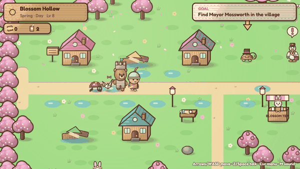

### [▶ Play it in your browser](https://normansrule.github.io/cardboard-kingdom/) · [⬇ Download](https://github.com/Normansrule/cardboard-kingdom/releases/latest) · [📜 Changelog](CHANGELOG.md) · [🎨 How each version was built](docs/media/process/README.md)

Alone or with a friend on one keyboard. No install, no internet, no dependencies.<br>
Written from scratch on a tiny custom JavaScript engine: canvas, ~18,700 lines, every sprite drawn in code.

</div>

---

## 🗺️ The road so far


## 📊 Progress tracker


<details open>
<summary><b>The checklist behind the bars</b></summary>

| Area | Status | Notes |
|---|---|---|
| Main story: prologue, Chapters 1 to 14, epilogue | ✅ done | All playable start to finish, solo or two-player co-op. |
| Four seasons, day and night | ✅ done | Spring, summer, fall and winter chapters, each with a night version. |
| Costume Quest battles (Act, Guard, Help, Inspect, Specials) | ✅ done | 12 costumes, each with a battle form; timing helps but never gates. |
| Engineering puzzles with a Test button | ✅ done | 13 puzzles, from dams to live valves; Grandma's Blueprint if you're stuck. |
| Repairs stay visible | ✅ done | Postcards before/after, the Neighbor Round, the Thimble Row colour bloom. |
| Easy Play (Story Mode, goal marker, text speed) | ✅ done | |
| Cozy extras: fishing, fruit trees, the Post, Patchwork Hall | ✅ done | |
| Companions who follow you | 🟨 1 of 3 | Rivet (2.15). Two more planned. |
| Walk-in interiors | 🟨 some | Patchwork Hall, the engineering studio, inside the Teapot. Houses are knock-and-talk. |
| Destinations from the design direction | 🟨 2 of 16 | The Ferryyard and Reedwhistle Marsh so far. |
| Atlas prototypes (festival neighborhood, a place that improves, three-room puzzle) | ✅ 3 done | Thimble Row covers all three. |
| Atlas prototypes (delivery kart, giant repair machine) | ⬜ planned | |
| Toon-shaded 3D renderer | ➖ not planned | The game is a 2.5D canvas engine on purpose. |

</details>

---

## 🎬 Every place, right now

Every stop on that road is playable today. Here's what each one looks like right now, recorded from the current build:

<table>
<tr>
<td align="center" width="33%">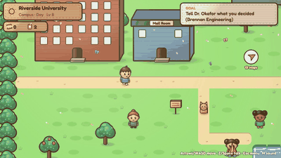<br><b>Prologue + Ch. 6 + Ch. 13 · Riverside University</b><br><sub>The real world: grey until Sam finds their way back, then in colour.</sub></td>
<td align="center" width="33%"><br><b>Ch. 1 · Blossom Hollow</b> (spring)<br><sub>Cherry blossoms, a cardboard dam, and the "monster raiders" who aren't.</sub></td>
<td align="center" width="33%">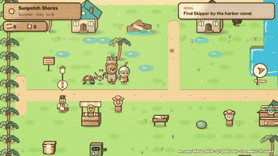<br><b>Ch. 2 · Sunpatch Shores</b> (summer)<br><sub>Beaches, flood gates, and the Silver Quill Society.</sub></td>
</tr>
<tr>
<td align="center">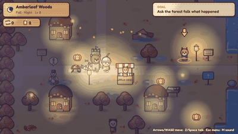<br><b>Ch. 3 · Amberleaf Woods</b> (fall)<br><sub>Falling leaves, a truss bridge, and a charter drawn by an 8-year-old.</sub></td>
<td align="center">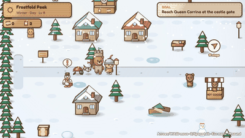<br><b>Ch. 4 · Frostfold Peak</b> (winter)<br><sub>Snow, Grandma's Summit Dam, and the storm that is Sam's own discouragement.</sub></td>
<td align="center">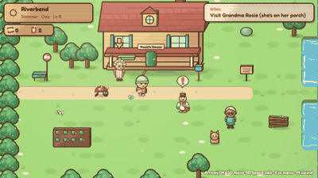<br><b>Ch. 7 · Paper Birds</b> (Riverbend)<br><sub>Grandma's cottage, the first Kingdom in the attic, a stone arch.</sub></td>
</tr>
<tr>
<td align="center">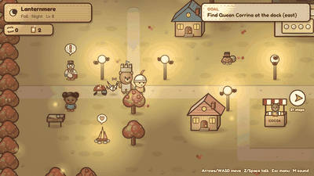<br><b>Ch. 8 · The Lantern Festival</b><br><sub>So many lanterns there are no stars. Light the path, not the sky.</sub></td>
<td align="center">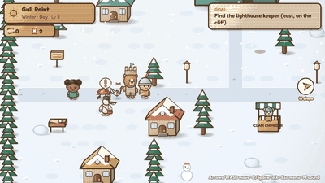<br><b>Ch. 9 · The Keeper's Light</b> (Gull Point)<br><sub>A leaning lighthouse, a living shoreline, Jules's grandpa's logbook.</sub></td>
<td align="center">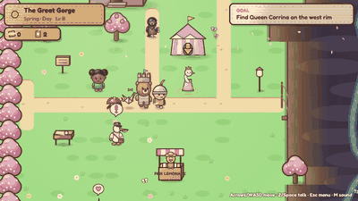<br><b>Ch. 10 · The Long Bridge</b><br><sub>Kites, Whirligigs, a suspension bridge, and the box going soft.</sub></td>
</tr>
<tr>
<td align="center">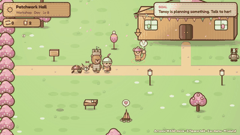<br><b>Patchwork Hall</b> (the hub)<br><sub>Tansy and Brindle, the Postcard Wall, the aquarium, the Costume Parade.</sub></td>
<td align="center">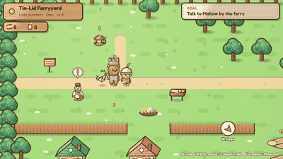<br><b>Ch. 11 · The Ferryyard</b><br><sub>Stilt houses and a ramp everyone can use. Ask who needs to use it.</sub></td>
<td align="center">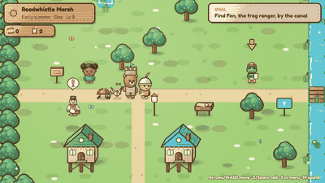<br><b>Ch. 12 · Reedwhistle Marsh</b><br><sub>Fishing, Fen the frog ranger, and putting the bends back in a brook.</sub></td>
</tr>
<tr>
<td align="center">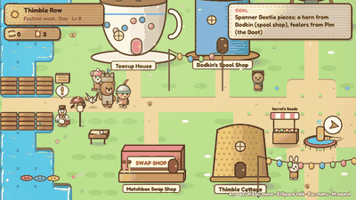<br><b>Ch. 14 · Thimble Row</b><br><sub>A tiny neighborhood in giant teacups and boots, and a festival.</sub></td>
<td align="center">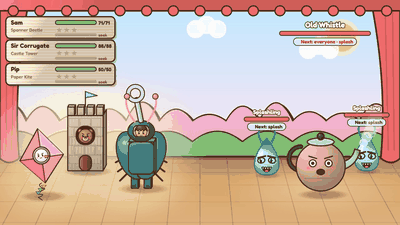<br><b>Battles</b><br><sub>Costume Quest-style: everyday costumes become giant battle forms.</sub></td>
<td align="center"><br><b>New in 2.15 · Rivet</b><br><sub>A bottle-cap beetle who follows you and digs up buried buttons.</sub></td>
</tr>
</table>

---

## 🛠️ Engineering puzzles, in motion

Every chapter is fixed by building something real, scaled down to cardboard. The water is simulated, so you watch a design work (or fail) instead of being told.

| Spillway (Ch. 4) | Festival lights (Ch. 8) | Accessible ramp (Ch. 11) |
|---|---|---|
|  |  |  |
| **Give the bends back (Ch. 12)** | **The model bridge (Ch. 13)** | **Live valves, then the colour comes back (Ch. 14)** |
|  |  | 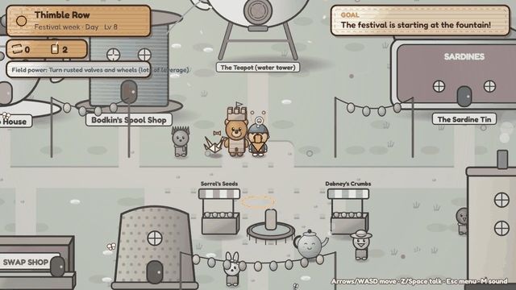 |

Also: dams, flood gates, truss bridges, rain gardens, stone arches, a living shoreline, a suspension bridge, and Grandma's Blueprint whenever you're stuck.

## 🎭 Costumes, friends and cozy things

| Kite flight | Fishing anywhere (14 kinds) | Neighbors you've helped |
|---|---|---|
|  |  |  |

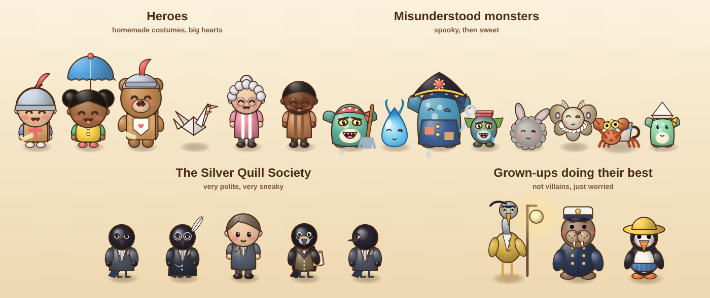

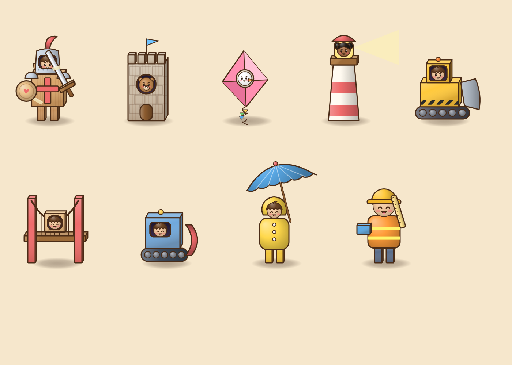

---

## 📈 Built round by round

Each version's folder shows how it was made: before, work-in-progress, and final captures from the real game.

| Version | What it added | A look |
|---|---|---|
| **2.15** | **Rivet**, a companion who follows you and digs up buttons; this new README |  |
| [2.14](docs/media/process/v2.14/README.md) | Ch. 14 Thimble Row: the Spanner Beetle, live valve rooms, the colour bloom, festival night | 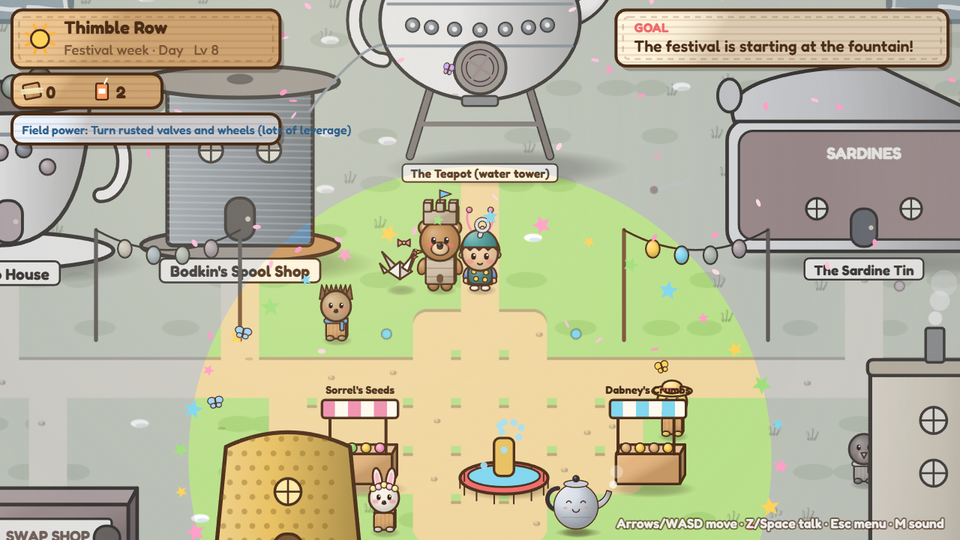 |
| [2.13](docs/media/process/v2.13/README.md) | Ch. 13 Home Again: Ren, the engineering studio, Crit Day, one next step | 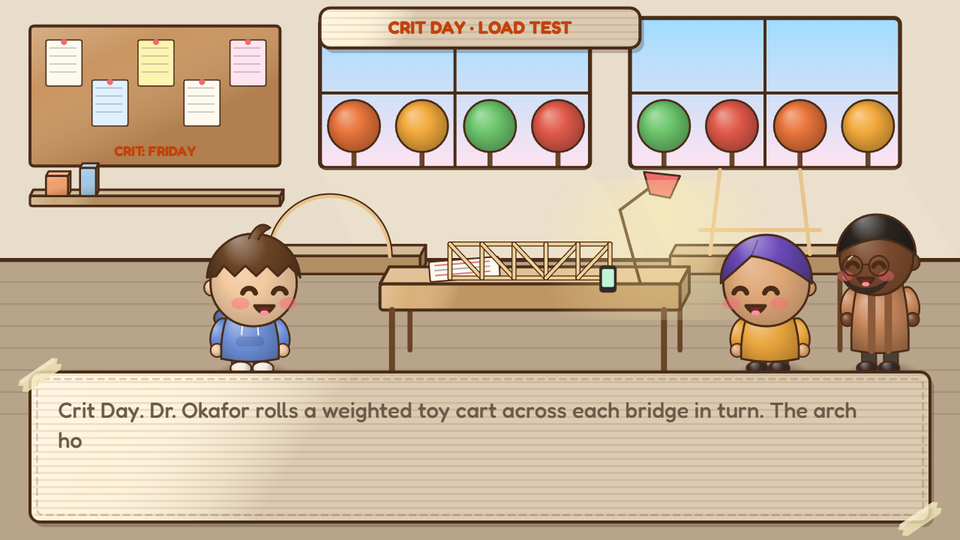 |
| [2.12](docs/media/process/v2.12/README.md) | Ch. 12 Reedwhistle Marsh, fishing, the aquarium | 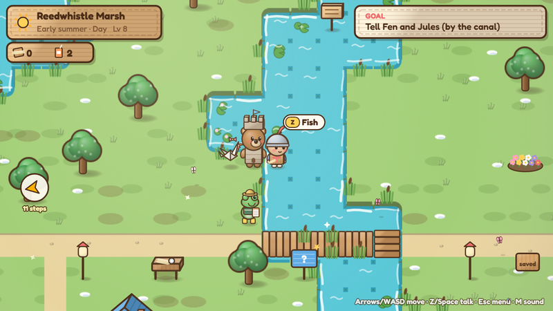 |
| [2.11](docs/media/process/v2.11/README.md) | Costume pieces, the Lantern Moth and Reed Warden, the Costume Parade | 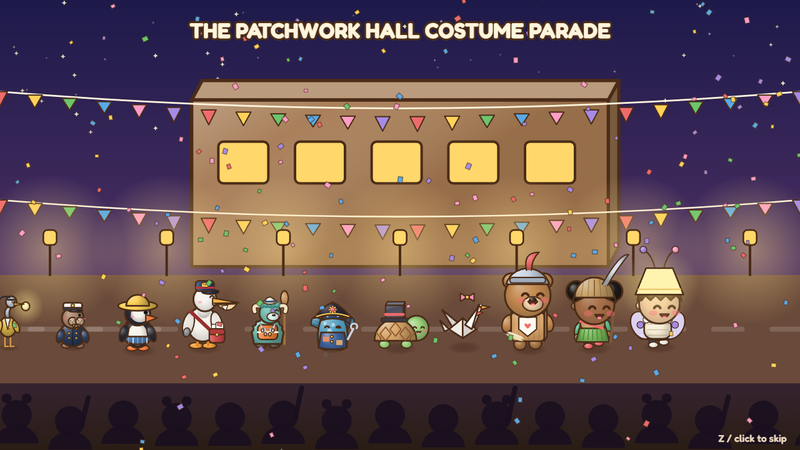 |
| [2.10](docs/media/process/v2.10/README.md) | Ch. 11 The Ferryyard, foamy water, fruit trees, name tags | 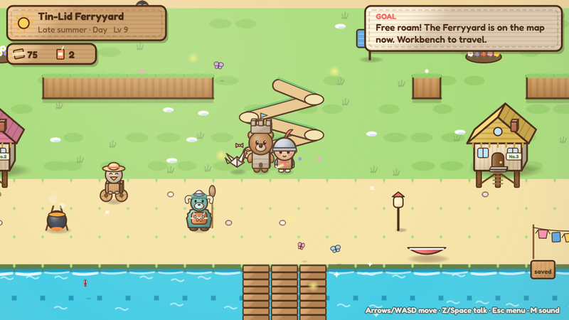 |
| [2.9](docs/media/process/v2.9/README.md) | Patchwork Hall, before/after postcards | 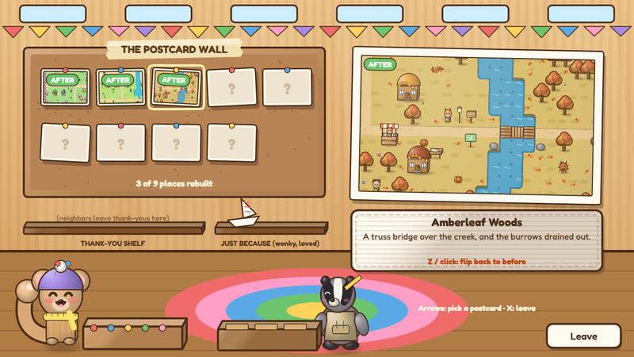 |
| 2.8 | Act / Guard / Help / Inspect in battle, the Neighbor Round | 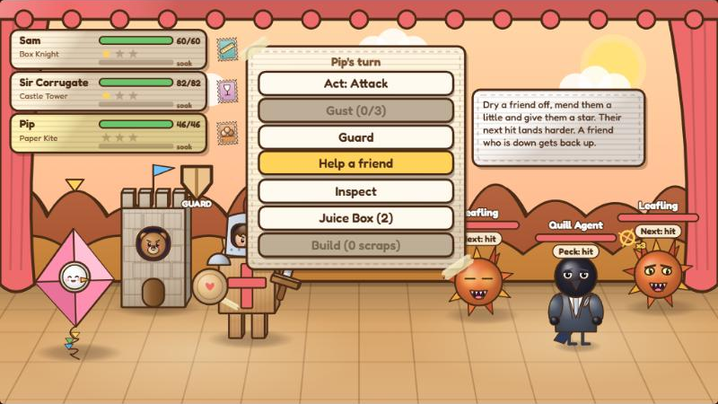 |
| 2.7 | The Kingdom Post: Pell, lost letters, Battle Stamps | 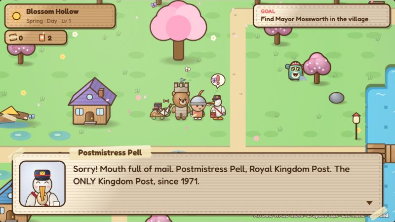 |
| 2.0 to 2.6 | The four seasons, the real world, chapters 6 to 10, co-op, Easy Play |  |

The full reference set of the current game (every place, day and night, every boss and puzzle) is in [docs/media/current](docs/media/current/README.md).

---

## 📖 The story at a glance

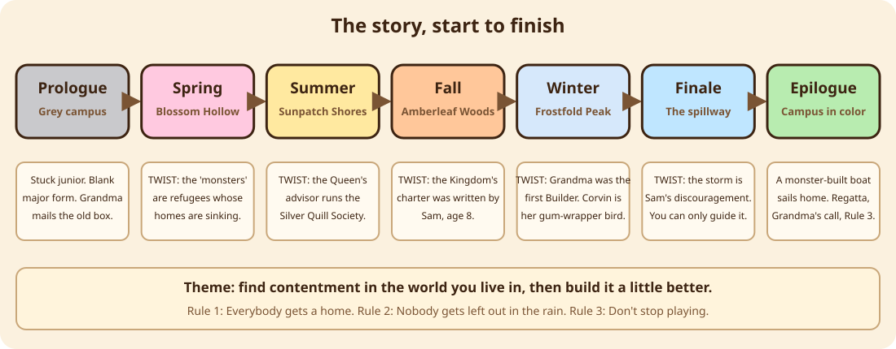

Sam is a civil-engineering student who has stopped enjoying it. One rainy evening a glowing fridge box in the
campus recycling center turns out to be a door into the **Cardboard Kingdom**, a world of animals and birds
whose cardboard homes are being flooded by **water pirates**.

Over one year (spring, summer, fall, winter) Sam and friends build their way through the kingdom, and the
story keeps turning over:

1. **Spring.** The "monster raiders" are refugees patching their own sinking homes.
2. **Summer.** The Queen's advisor, Magister Corvin, runs the **Silver Quill Society**, which floods land on purpose, blames the monsters, and buys it cheap.
3. **Fall.** The Kingdom's charter was drawn by Sam at age 8. Corry and Pip came from that same fridge box.
4. **Winter.** The endless storm is Sam's own discouragement. It can't be beaten, only given somewhere to go.
5. **The hard hat says ROSIE.** Grandma was the first Builder, the Summit Dam is hers, and the spillway was what was missing.
6. **Corvin** turns out to be a gum-wrapper bird Rosie folded long ago.
7. **The boat home.** Sam sails back to campus, where the real world has its color back, and there's a regatta to race.
8. **Storm Season (Chapter 6).** A developer with a silver quill pin wants to fill in Reyes Pond for a parking garage. That night a storm hits, Corry climbs out of the box for real, and Gutter Gremlins pour out of the drain. They're not attacking. Their drain is flooded because the campus is paved over.
9. **The silver quill was a prize.** Mr. Penwright was Grandma Rosie's student in 1989, and the pin was her award for the best blueprint. He isn't a villain, he just forgot why he loved building. Sam's rain-garden numbers win the town meeting, and Grandma's journal gets **Rule Four: Leave room for the rain.**
10. **Paper Birds (Chapter 7).** At Grandma's house, the "monsters" in the attic are Dust Bunnies: the dust of the very first cardboard Kingdom, which Grandma built in 1971 and packed away. Grandma can see Pip, because she taught Sam to fold him.
11. **Corvin comes home.** Rosie folded Corvin at age 11, the day her first footbridge washed away, and asked him to keep her ideas safe. He kept them locked up so long it turned into a secret society. Corvin's old deputy, Mortimer Rook, just wants to matter, and becomes the bridge inspector. Sam finishes Grandma's bridge as a stone arch, and the journal gets **Rule Five: an arch stands because every stone leans on the next one.**
12. **The Lantern Festival (Chapter 8).** Jules comes through the box this time. Lanternmere's lanterns are so bright there are no stars, and the "attacking" Moth-kin are just lost: with no moon to steer by, they circle every lamp. Mr. Lux sells the glare because he was lost on a dark marsh as a chick and never wants anyone to feel that again.
13. **Grandma hung the moon.** Jules admits they've been scared of the dark since their grandpa, a lighthouse keeper, died: "A lighthouse doesn't light up the whole sky. It points." The friends redo the festival with hooded lanterns, the stars return, and the moon turns out to be a paper lantern with a note in pencil: *FOR WHOEVER IS LOST: LOOK UP. R.R., 1971.* Jules writes **Rule Six: light the path, not the sky.**
14. **The Keeper's Light (Chapter 9).** A frosted postcard in Jules's grandpa's handwriting leads to Gull Point, where a cardboard lighthouse leans over a crumbling cliff. Keeper Gale, a puffin, says it was built by a boy called Keeper Ike: Jules's grandpa, Isaac. Harbormaster Brack wants a giant seawall because his family's cottage was lost to a storm when he was young. The Shellbacks raid the wall site because the rubble buried their tidepools.
15. **Ike and Rosie were friends.** Old Tin has kept Ike's logbook in a jam jar since 1972: *"Rosie says you can't stop the sea. You can only slow it down, and step back when you need to."* That's why the box let Jules through. The friends build a living shoreline, roll the whole lighthouse back from the edge, and Jules finds a pencil mark on the stair wall labeled *MY GRANDKID, SOMEDAY?* Jules lights the lamp and writes **Rule Seven: work with the water, not against it.**

16. **The Long Bridge (Chapter 10).** The box is soaking up a week of spring rain. Inside, the first Kingdom Fair in a hundred years can't start, because the old rope bridge over the Great Gorge washed away in Sam's Endless Storm. Inspector Rook (yes, that Rook) needs one line across, but the Whirligigs keep blowing everything into the gorge.
17. **The last of the storm.** The Whirligigs are leftover wind, and the small grey cloud on the rim is the **Little Drizzle**: the voice at two in the morning that says you'll never finish anything. Sam doesn't beat it. They invite it to rain on the gardens. Pip, remembering the 1848 kite contest at Niagara, flies the first line across, and the whole Kingdom builds a suspension bridge.
18. **The box goes soft.** At the Fair, Sam's hand starts to turn to wet cardboard. Corry gives Sam his very last gold star and sends them home. The old box folds flat in the rain. Grandma calls: hers went soft in 1974, and Ike brought round another box. *"A door isn't the box, love. It's what you build in it. And who you build it with."* Sam and Jules build a new one from Jules's mini-fridge box, and Corry pops straight through: **FRONT ROW!** Rule Eight: **build it together, and build it again.**

19. **The Kingdom Post.** Postmistress Pell has carried every letter in the Kingdom since 1971, including the ones nobody could deliver. The storms scatter fifty years of them. Mayor Mossworth wrote to himself at twenty and never left the Hollow ("that is the whole job"). Sam wrote to Professor Hoot at eight, in crayon. Corvin wrote to the Queen the night he started the Society, and never sent it. And Pell is the one who has been putting things in the box all along: Ike's postcard was addressed "To my grandkid, someday," and she waited 54 years for someday.
20. **To whoever builds next.** The last letter in Pell's pouch is from Rosie, age fourteen, the week her first box went soft: *"You don't have to be finished to be good. Bring snacks. Build it with somebody. It stands up better."* Sam writes one back, for whoever builds after them.

21. **The Ferryyard (Chapter 11).** A riverside town of stilt houses that was never put on the Kingdom's map, where a forgotten Silver Quill machine stamps DENIED on every door. Mallow the ferryperson and Ibis, the nervous archivist who drew the map that left it off, help Sam build a switchback ramp from the ferry dock to the high road that Grandpa Wick's cardboard wheelchair can actually use. **Rule Nine: ask who needs to use it.**
22. **Reedwhistle Marsh (Chapter 12).** The Silver Quill straightened a brook into a canal, so the fish are gone and Lilypad Row floods. Fen the frog ranger counts fish every morning. Free The Gulp, a panicking giant catfish, and redesign the brook with bends and pools. Jules realises they want to look after rivers. **Rule Ten: give it room to wander.**
23. **Home Again (Chapter 13).** Back on campus, Sam answers a message they've ignored for three weeks, rebuilds a crushed model bridge with their classmate Ren, survives Crit Day, and picks one next step with Dr. Okafor. Then they glue one corner of the old model back together. **Rule Eleven: take the next step, not every step.**
24. **Thimble Row (Chapter 14).** A tiny neighborhood in giant teacups and boots, grey and flooded because the Teapot water tower's valves rusted shut when its keeper retired and "everybody thought somebody else knew how." The Spanner Beetle costume, Old Whistle the pressure kettle, three rooms of live valves, and the colour blooming back. **Rule Twelve: start with your own street.** After the festival, a bottle-cap beetle named **Rivet** picks Sam and comes along.

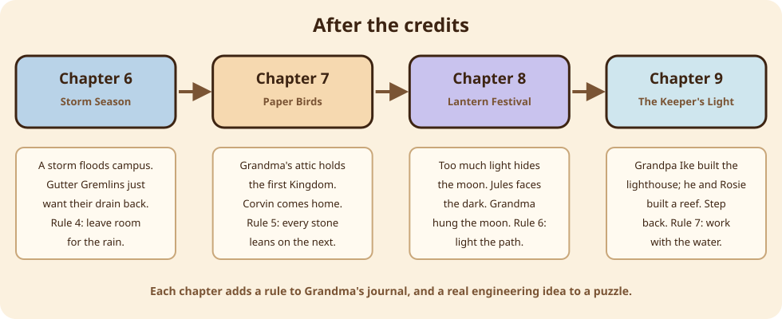

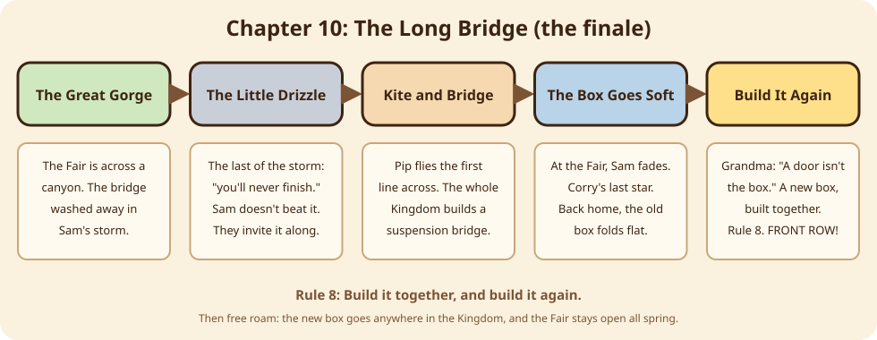

The lesson: you don't have to have everything figured out to build something good, and contentment comes
from making things with the people around you.

## 🧠 The soak system

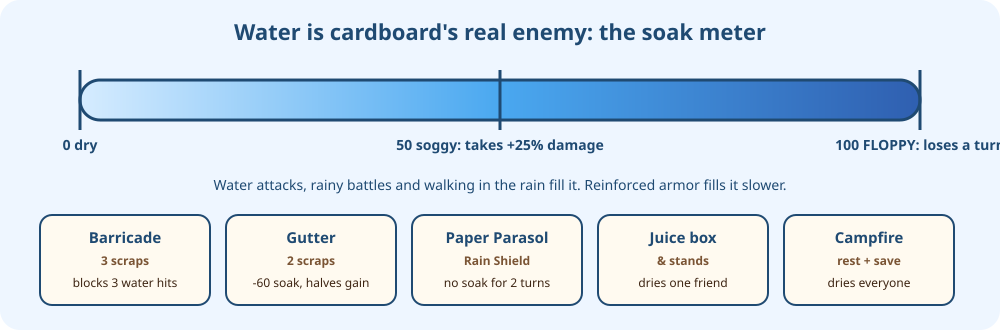

## 🎮 Controls

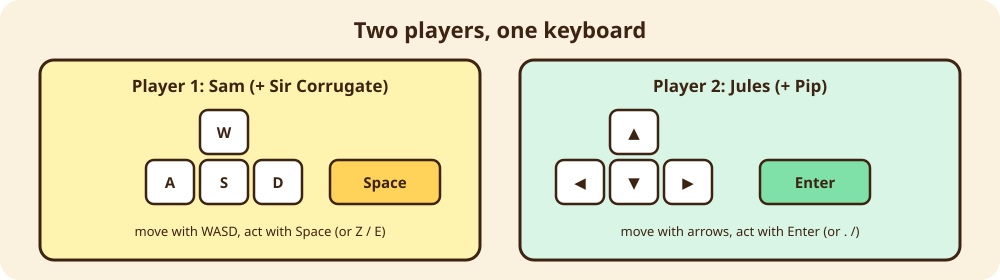

| Action | Solo | Player 1 (co-op) | Player 2 (co-op) |
|---|---|---|---|
| Move | Arrows / WASD / click | WASD | Arrow keys |
| Talk / confirm | Z, Space, Enter | Space, Z, E, F | Enter, `.`, `/`, Right Shift, Numpad 0 |
| Back | X, Esc | X, Q, Esc | Backspace, `,` |
| Menu | Esc | Esc | Esc |
| Run | Shift | Left Shift | `'` (quote) |
| Sound | M | M | M |

In co-op battles, Player 1 controls **Sam + Sir Corrugate** and Player 2 controls **Jules + Pip**.

---

## ⬇️ Download and play on any computer

**From a GitHub Release (easiest):**
1. Go to your repo's **Releases** page and download `cardboard-kingdom-2.15.0.zip`.
2. Unzip it.
3. Double-click the launcher for your system:
   - **Windows:** `play.bat`
   - **macOS:** `play.command` (the first time, right-click it and choose **Open**)
   - **Linux:** `play.sh`, or run `bash play.sh` in a terminal
4. Or open `cardboard-kingdom-single-file.html` in any browser. That one file holds the whole game.

**Online:** [normansrule.github.io/cardboard-kingdom](https://normansrule.github.io/cardboard-kingdom/) (GitHub Pages).

**From source:** clone the repo and open `index.html`. There is no build step.

## 🏗️ How it's built

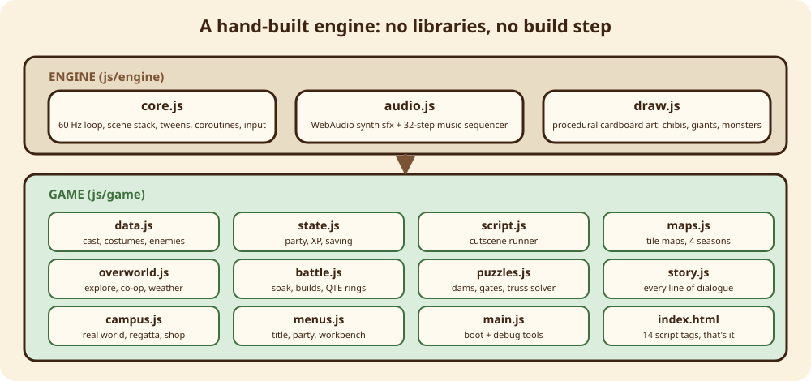

```
cardboard-kingdom/
├── index.html              # loads the scripts in order, nothing else
├── js/
│   ├── main.js             # boot + debug helpers (CK.debug.chapter, CK.debug.puzzle)
│   ├── engine/
│   │   ├── core.js         # loop (fixed 60 Hz), scenes, input (per-player keymaps), tweens, coroutines
│   │   ├── audio.js        # synthesized sound effects and music (WebAudio, no files)
│   │   ├── draw.js         # 2.5D drawing helpers (volume shading, boxes, shadows) and props
│   │   └── chars.js        # every character, costume, battle form and monster, drawn in code
│   └── game/
│       ├── data.js         # party, costumes, enemies, builds, shop, seasons
│       ├── state.js        # new game, save/load (localStorage)
│       ├── script.js       # tiny cutscene language: say, move, fn, coop/solo, await
│       ├── maps.js         # the four seasonal maps
│       ├── campus.js       # real-world prologue, epilogue, shop, regatta
│       ├── overworld.js    # exploring, weather, field powers, co-op camera
│       ├── battle.js       # turn-based battles, soak, building, timed hits
│       ├── puzzles.js      # engineering puzzles + Grandma's Blueprint
│       ├── story.js        # chapter scripts and twists (chapters 1-5)
│       ├── storm.js        # Chapter 6: Storm Season, Gutter Gremlins, rain-garden puzzle
│       ├── riverbend.js    # Chapter 7: Paper Birds, Grandma's cottage, stone-arch puzzle
│       ├── lanternmere.js  # Chapter 8: The Lantern Festival, dark-sky lighting puzzle, festival finale
│       ├── gullpoint.js    # Chapter 9: The Keeper's Light, living-shoreline puzzle, Heave! minigame
│       ├── friends.js      # campfire talks, bonds, banter bubbles, idle fidgets, emotes, Friends page
│       ├── assist.js       # Easy Play: Settings, Story Mode, goal marker, running, text speed
│       ├── longbridge.js   # Chapter 10: The Long Bridge, kite flight, suspension-bridge puzzle, finale
│       ├── post.js         # The Kingdom Post: Postmistress Pell, Lost Letters, Battle Stamps, Stamp Book
│       ├── neighbors.js    # The Neighbor Round: thank-you visits and errands after each repair
│       ├── patchwork.js    # Patchwork Hall: Tansy, Brindle, the hall interior, before/after postcards
│       ├── ferryyard.js    # Chapter 11: The Ferryyard, Mallow, Ibis, the Archive, the accessible-ramp puzzle
│       ├── cozy.js         # Cozy pass: foamy water, shakeable fruit trees, name tags
│       ├── costumes.js     # Lantern Moth + Reed Warden, costume pieces, the Costume Parade, transformation flash
│       ├── marsh.js        # Fishing, the Fish Count + aquarium, Chapter 12: Reedwhistle Marsh, the bends puzzle
│       ├── home.js         # Chapter 13: Home Again (Ren, the engineering studio, the model bridge, Crit Day)
│       ├── thimble.js      # Chapter 14: Thimble Row (Spanner Beetle, Old Whistle, the valve rooms, the colour bloom)
│       ├── rivet.js        # Rivet, the bottle-cap beetle companion: following, sniffing out and digging up buttons
│       └── menus.js        # title, pause, party, workbench, ending, credits
├── tools/
│   ├── build_single.py     # inlines everything into dist/cardboard-kingdom.html
│   └── package.sh          # builds dist/cardboard-kingdom-<VERSION>.zip
├── play.sh / play.command / play.bat / PLAY.txt
├── docs/media/             # readme/ (the animated tour), current/ (reference set), process/ (how each version was built)
└── .github/workflows/
    ├── check.yml           # syntax-checks every script on each push
    ├── pages.yml           # publishes the game to GitHub Pages
    └── release.yml         # tag v* -> builds the zip and attaches it to a Release
```

**Engine highlights**
- No dependencies, no bundler. Plain `<script>` tags sharing a global `CK` namespace.
- Fixed-timestep 60 Hz update with a scene stack (overworld → dialog → battle → puzzle …).
- Cutscenes are generator-based coroutines (`CK.co`) driven by a small script language.
- All art is vector-drawn on the canvas at runtime, so the whole game is about 450 KB.
- 2.5D look: `D.box3` draws cardboard boxes with a lit top and a shaded side, `D.ball`/`D.egg` add radial volume shading, and tree canopies are cached to offscreen canvases so the extra shading stays fast.
- The grey prologue is a single `saturation` blend fill. (`ctx.filter` was tried and froze some browsers.)

## 🧪 Developer notes

```bash
# run locally (any static server works, or just open index.html)
python3 -m http.server 8000      # then visit http://localhost:8000

# check every script parses
for f in js/*.js js/*/*.js; do node --check "$f"; done

# build the single-file game and the download zip
python3 tools/build_single.py
bash tools/package.sh
```

Debug helpers in the browser console: `CK.debug.chapter('summer')` jumps to a chapter, `CK.startPuzzle('rain_garden')`, `CK.startPuzzle('willow_arch')` `CK.startPuzzle('festival_lights')` and `CK.startPuzzle('living_shore')` and `CK.startPuzzle('long_bridge')` open the Chapter 6 to 10 puzzles, and
`CK.autoSkip = true` fast-forwards dialog. `CK.runScript(CK.talkScript('pip'))` plays Pip's next campfire talk. `CK.debugPost.stamps()` gives every Battle Stamp, `CK.debugPost.letters()` finds every letter and `CK.debugPost.deliverAll()` delivers them, so the next talk with Pell opens her last letter.

## 📜 Versions

See [CHANGELOG.md](CHANGELOG.md).

---

Made with cardboard, tape, and a lot of love. 📦💛
