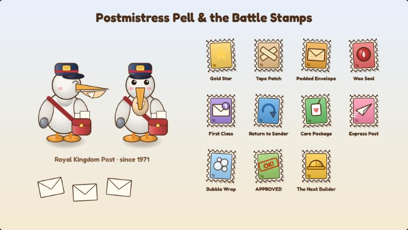

# 🧸 Cardboard Kingdom: Character Bible

Who everyone is, what they want, what they're scared of, and how they talk.
In the game, the **Friends** page in the pause menu shows the same profiles, and **Campfire Talks** reveal the rest.

---

## The party

### Sam: the Builder (reluctantly)
*Pronouns: they/them. Civil-engineering student, second year.*

| | |
|---|---|
| **Wants** | To want something. Anything. Properly. |
| **Fears** | Being ordinary. Letting Grandma down. |
| **Quirk** | Doodles tiny bridges on napkins, receipts, homework and their own hand. Says "okay okay okay" when overwhelmed. |
| **Likes** | Lists. Rainy windows. Grandma's sketchbook. Problem sets, secretly. |
| **Secret** | Kept every Kingdom drawing from age eight in a shoebox under the bed. Even the bad ones. |
| **Voice** | Dry, quiet, honest. Makes jokes when cornered ("Is it load-bearing?" "Emotionally."). |
| **Idle fidget** | A big stretch, then a bridge doodle in the air. |

**Arc.** Sam starts the game numb, not sad. By the end they can say what they want out loud, to Jules, by a campfire:
*"I want to build things that let people stay. In their homes. By their ponds. Near their crabs."*

---

### Sir Corrugate ("Corry"): Knight of the Fridge Box
*A teddy bear in fridge-box armor with a pot helmet. Made by Sam at age eight.*

| | |
|---|---|
| **Wants** | To do one truly Great Deed. |
| **Fears** | Ordinary rain. Being put back in a box. |
| **Quirk** | Keeps a **Ledger of Deeds** and awards gold-star stickers for bravery. Only has nine left. Speaks exclusively in proclamations. |
| **Likes** | Polishing his pot helmet. Front-row seats. Double knots ("a knightly knot"). |
| **Secret** | Spent twelve years in a box in Grandma's garage, waiting. He was never angry. He just wondered. |
| **Voice** | Formal, earnest, accidentally funny. "That was a battle cry. A wet one." |
| **Idle fidget** | Rocks happily while polishing his helmet, with sparkles. |

**Arc.** Corry has done 412 Small Deeds, 30 Medium and zero Great. In his last talk he works out that a Great Deed is just a lot of Small ones, done by friends, that nobody wrote down, and he finally fills in the last page: *GREAT DEED NO. 1. EVERYTHING. TOGETHER.* At the Fair in Chapter 10 he gives Sam his very last gold star, for Great Deed No. 2: front row.
Sam was the one who drew his face. The first try was too angry, the second too surprised, and the third was "brave, but nice."

---

### Pip: a kite folded in five minutes
*A white paper kite-bird with an orange beak and a piece of tape on the tail.*

| | |
|---|---|
| **Wants** | To fly above the clouds. |
| **Fears** | Scissors. Being "just paper". |
| **Quirk** | Counts everything: stars, steps, buckets, bats. Knows a fact for every occasion and talks at about three hundred words a minute. |
| **Likes** | Wind. Facts. Being held on to. |
| **Secret** | The tape on Pip's tail is Grandma's very first repair, from the day eight-year-old Sam tore it on a fence. |
| **Voice** | Fast, bright, oddly precise. "Seven. But who's counting. Me. I am counting." |
| **Idle fidget** | A full loop-the-loop. |

**Arc.** Pip counts because "when I count, my string stops feeling wobbly." Their last talk turns that around: *"A kite isn't a thing that flies. It's a thing that flies with someone."* ("That's not a fact. It's a feeling. I am branching out.") In Chapter 10, Pip proves it by flying the first line across the Great Gorge.

---

### Jules Marsh: the roommate
*Pronouns: they/them. Officially pre-med. Actually marine biology since October.*

| | |
|---|---|
| **Wants** | To matter to someone. To count fish and make sure they're okay. |
| **Fears** | The dark. Disappointing a whole family of doctors. |
| **Quirk** | Names every animal on sight (that gull is Brenda). Hums sea shanties when nervous. Can get lost in a straight hallway. |
| **Likes** | Octopuses, gulls, bad puns, the desk lamp being left on. |
| **Secret** | Switched out of pre-med in October and hasn't told anyone at home. |
| **Voice** | Warm, rambling, deflects with jokes. "You're a really good roommate. I hate it." |
| **Idle fidget** | Sways and hums, with floating music notes. |

**Arc.** Jules's grandpa was Isaac "Ike" Marsh, the Keeper of Gull Point. After lighting his lamp, Jules finally calls home. Their mom cries, then asks if fish get sick: *"So you're a doctor after all."*
Sam always left the desk lamp on first semester. Jules noticed.

---

### Grandma Rosie: the first Builder
*Rosalind Reyes. Retired civil engineer. Built the first Cardboard Kingdom in 1971.*

| | |
|---|---|
| **Wants** | For Sam to stop trying to be finished. |
| **Fears** | Being treated as fragile. |
| **Quirk** | Cheats at gin rummy, badly. Says "pish." Keeps a pencil behind each ear in case one gets lost. |
| **Likes** | Arches, her garden, burnt sugar, a good argument. |
| **Secret** | Knew Jules was Ike's grandkid from Sam's very first letter home. |
| **Voice** | Brisk, funny, tender only when nobody's looking. "Pish. That is a decorative card." |

**Arc.** Her talks fill in what the chapters only hint at: the footbridge that washed away when she was eleven (which is where Corvin came from), the summer she hung a paper moon over Lanternmere because she couldn't sleep, and fifty years of letters with Ike.
*"Missing someone is just love with nowhere to go. So give it somewhere to go."*

---

## New in Chapter 10

### The Little Drizzle: the last of the storm
*A small grey cloud, sitting on the rim of the Great Gorge, quietly raining on itself.*

| | |
|---|---|
| **Wants** | To be invited somewhere. Anywhere. |
| **Fears** | Being "just weather". |
| **Quirk** | Announces that it is VERY scary. Is about the size of a beanbag. |
| **Likes** | Gardens (it didn't know yet). Rainy Sundays. Being thanked. |
| **Secret** | It's the bit of Sam's Endless Storm that says "you'll never finish anything." It was supposed to make Sam give up. |
| **Voice** | Gloomy, formal, a little hopeful. "I have never been invited anywhere." |

**Arc.** Sam can't beat it: it's part of the weather. So Sam invites it along to water the gardens (Rule Four), and by the end it rains a tiny bit indoors, apologetically, at the new box.

### The Whirligigs
Paper pinwheels on pencils with button faces: leftover wind from the Endless Storm. They can't stop spinning and nobody told them where to go. Once someone does, they turn out to be VERY good at wind, and their updrafts carry Pip across the gorge. ("It turns out wind is just air that wants to go somewhere.")

### Familiar faces at the Fair
Inspector Rook (forty-one stamps, a personal best), Mayor Mossworth dancing with Captain Bess, Brack carrying Old Tin in a bucket with a HANDLE, Mr. Lux handing out lanterns that only light your feet, and the Moth-kin, who can see both the moon and the bridge.

## New in 2.7: the Kingdom Post

### Postmistress Pell: the only post-bird in the Kingdom
*A big white pelican in a navy postal cap with a gold envelope badge, a red satchel, and a beak pouch full of mail.*

| | |
|---|---|
| **Wants** | Every letter to arrive. Every single one. |
| **Fears** | The letter that never gets there. |
| **Quirk** | Talks through a mouthful of envelopes ("Mmf. MMF.") until she tips them into her satchel. Knows exactly how many letters she has delivered: four hundred and twelve thousand and six. Seven, if you count the one she sat on. Makes up Post Office rules on the spot. |
| **Likes** | Quiet routes. A good, loud stamp. Being asked how many. |
| **Secret** | She has carried one letter in the bottom of her pouch since 1974, addressed "To whoever builds next." Nobody ever built next, until Sam. |
| **Voice** | Brisk, cheerful, a bit breathless. "Post Office rules. I made them up." |

**Arc.** Pell keeps every letter nobody can deliver, because somebody has to. This year's storms burst her dead-letter bag and scattered fifty years of them across the Kingdom. As Sam brings them home, it turns out Pell is the one who has been putting things in the box all along: Ike's postcard in Chapter 9 was addressed "To my grandkid, someday," and she waited 54 years for someday to come through the box. When all eight letters are home, she finally hands over the oldest one. Then she takes Sam's reply and tucks it into the bottom of her pouch, for whoever builds after them.

### The Lost Letters

| Letter | From | What it says | What it shows |
|---|---|---|---|
| To Mayor Mossworth | Himself, aged 20 (1925) | "Did I go past the hills? Was it wonderful?" | He stayed and looked after the brook. "Young Builder, that is the whole job." |
| To Captain Bess | Her mum, eleven summers ago | "Come home when you're ready. The kettle's always on. P.S. Wear a hat." | Bess turned pirate to get her family a new island. She promises to sail home with a dam design. |
| To Professor Hoot | **Sam, age 8**, in crayon | "Rivers always go DOWN hill. That is the main thing." | Hoot has taught it every autumn for twenty years. Sam drew him his glasses. Pip will never let this go ("Professor Sam"). |
| To Queen Corrina | Corvin, never sent | "I do not know what else to do with being afraid." | The Silver Quill started the night he got scared of the rain. |
| To Grandma Rosie | Ike, 1975 (51 years late) | "Got your box. I built a lighthouse in it. P.S. You cheat." | The Gull Point lighthouse was built in a box Rosie sent him. "Every builder needs one person who sends them a box." |
| To Mr. Lux | His mum | "If you are ever lost in the dark, stand still and listen for the reeds." | His first name is Luxley. He goes to listen to some reeds. |
| To Old Tin | Ike, 1972 | "If a kid with my nose turns up someday, show them the stairs." | Tin did exactly that, fifty-four years later. |
| To Inspector Rook | Corvin, 1990 (returned) | "You have a good eye. One day, build something with it." | He did: the Long Bridge. He stamps the letter. |
| To whoever builds next | Rosie, age 14 (1974) | "You don't have to be finished to be good. Bring snacks. Build it with somebody. It stands up better." | Pell's last letter. Sam writes one back. |

### Battle Stamps

Costume Quest-style perks. Each friend wears one; swap them in **Pause → Stamps & Letters**. Pell hands out the first two, and every delivered letter earns another.

| Stamp | Effect | How you get it |
|---|---|---|
| Gold Star | Hits land 15% harder | From Pell (goes on Corry, who may weep) |
| Tape Patch | Mends 8% HP at the start of each turn | From Pell |
| Padded Envelope | +20% max HP | Mayor Mossworth's letter |
| Wax Seal | Half as soaked | Captain Bess's letter |
| First Class | Starts battles with 2 special stars | Professor Hoot's letter |
| Return to Sender | PERFECT blocks hit back | The Queen's letter |
| Care Package | Juice boxes heal 50% more and dry everyone | Grandma's letter |
| Express Post | 30% chance to strike twice | Mr. Lux's letter |
| Bubble Wrap | The first hit each battle does nothing | Old Tin's letter |
| APPROVED | +50% scraps and XP | Inspector Rook's letter |
| The Next Builder | Get back up once per battle at half health; hits 10% harder | Rosie's letter |
| Handle with Care | Guarding blocks 75% and dries you off | Neighbor Round, 3 visits |
| Measure Twice | Inspect marks 3 hits at +70% | Neighbor Round, 6 visits |
| All Hands | Help gives 2 special stars | Neighbor Round, 9 visits |
| No One Left Behind | Help brings a downed friend back at 60% | Neighbor Round, 12 visits |

## New in 2.9: Patchwork Hall

### Tansy: the costume maker
*A dormouse with a big fluffy tail, a measuring-tape scarf, and pins stuck in her purple beanie.*

| | |
|---|---|
| **Wants** | Everyone making things again. Badly, if necessary. |
| **Fears** | A red pen. (She lost hers in 1998 and has been happier since.) |
| **Quirk** | Talks through a mouthful of pins. Makes the bad version of everything first, "to get it out of the way." |
| **Likes** | Lopsided things. Cereal-box linings. Brindle losing arguments. |
| **Voice** | Quick, delighted, generous. "It's PERFECT. Look how lopsided it is!" |

**Role.** From the design direction: Tansy helps Sam rediscover making things for pleasure rather than for evaluation. She asks Sam to make one thing just because (a hat for Pip, a cape for Corry, or a paper boat folded from a corrected problem set), and that is where Sam finally says, *"I used to make things because I wanted to see them work."*

### Brindle: the carpenter
*A stocky badger in a canvas apron, with a pencil behind one ear.*

| | |
|---|---|
| **Wants** | A roof that stays up. And to win the Spring Flower Show. |
| **Fears** | Being wrong in front of Tansy. |
| **Quirk** | Extremely confident about keystones. Fixed the hall roof twice ("the second time it stayed"). Intensely competitive about flower arranging. |
| **Voice** | Dry, short sentences. "Measure twice, cut once. Then, if Tansy's watching, measure a third time." |

**Role.** Experience matters, but familiar answers aren't always right. When Sam explains that an arch stands on its ends, not its keystone, Brindle grumbles, then quietly starts checking where things push before he builds.

## New in 2.10: the Ferryyard

### Mallow: the ferryperson
*A big, shaggy, teal horned creature in a sailor cap and an orange life vest, with a paddle and a necklace of spoons.*

| | |
|---|---|
| **Wants** | For the Ferryyard to count. |
| **Fears** | Another flood. Being called a monster by people who've never met them. |
| **Quirk** | Collects terrible souvenir spoons ("this one says I SURVIVED THE GORGE and the bowl is on backwards"). Speaks quietly, in short sentences. |
| **Voice** | "Ferry's free. Spoons are extra." |

**Role.** One of the "monster folk" from the flooded Brinemarsh. Some went to Captain Bess; some came here and built on stilts, "because we're good at water." Mallow carries the local knowledge Sam doesn't have.

### Ibis: the archivist
*A magpie in a moss-green cardigan, with round glasses, ink on her wingtips and an armful of rolled-up maps.*

| | |
|---|---|
| **Wants** | To un-draw a line. Since she can't, to draw a better one. |
| **Fears** | Being the reason. |
| **Quirk** | "I don't peck. I file." Keeps two copies of everything. Has started an archive of things the Society got wrong ("it's mostly me"). |

**Role.** The Silver Quill's archivist. Twenty years ago she drew the "Approved Neighborhoods" map and left the Ferryyard off it, because the rules said houses go on the ground. She kept the real map, made at night by lamplight, and helps put the Ferryyard back.

### Grandpa Wick
An old duck in a cardboard wheelchair and a fishing hat. "Folks keep building me stairs. Kind of them. Useless, but kind." The ramp is designed around what he tells Sam he needs, which is where Rule Nine comes from: **ask who needs to use it.**

## New in 2.15: Rivet

### Rivet: a bottle-cap beetle
*A red bottle cap for a shell, crimped all the way round, a small dark head, yellow-tipped feelers and six very busy legs.*

Bottle-cap beetles live on Thimble Row and pick one person, then follow them forever. Rivet sat by Sam's feet from the moment they came out of the Teapot. Rivet clicks to talk (twice means yes), can smell a buried button from across a field, and is enormously proud of every single one. Rivet doesn't go through the box to the real world; it guards the box until Sam comes back.

## New in 2.14: Thimble Row

Everyone on Thimble Row is crumb-sized and lives in something enormous.

### Mrs. Thimbleton
*A mouse seamstress in a pink beanie and a yellow scarf. Lives in the Teacup House.*

Polite, organised, and always carrying a list. She wrote to Sam on paper the size of a stamp. She is the one who says the line the chapter is about: "Everybody thought somebody else knew how." She sews the Spanner Beetle with a needle as long as your arm, and afterwards writes to the retired Waterkeeper: "We learned the valves. All of us. You may stay at the seaside."

### Bodkin
*A hedgehog with a blue scarf who runs the spool shop.*

Used to help the Waterkeeper oil the valves, then stopped, then forgot. He bends a paperclip into the Spanner Beetle's wrench horn ("I said that as a joke. She's really doing it?"). Afterwards he chalks every valve with what it does, in big letters, so the next person knows.

### Pim
*A robin kid in a yellow scarf who lives in the toe of the Boot.*

Has all the pipe cleaners. Pink ones, because pink is the bravest colour. Leads the second half of the costume parade in a pipe-cleaner crown.

### Sorrel and Dabney
A bunny who sells seed packets ("Plant them anywhere it floods. Roots drink.") and a duck who bakes crumb cake in the Sardine Tin, where each crumb is the size of your head.

### Old Whistle
The Teapot's dented copper pressure kettle. When the pressure is too high it whistles, and the Waterkeeper always came running. For a year, nobody did. After Sam calms it down it lives by the fountain and whistles in tune.

**Sam's arc.** Rule Twelve: *start with your own street.* Broken things often stay broken because everyone assumes someone else is looking after them.

## New in 2.13: Home Again

### Ren: Sam's studio classmate
*Purple side-swept hair, an orange sweater, and a bottle of wood glue that never runs out.*

Ren sat two desks away from Sam all term. Three weeks ago Ren sent Sam a message ("hey, want to team up for the bridge crit? no pressure :)") and never heard back, and quietly assumed it was because Ren's own design was bad. It wasn't: Sam wasn't answering anyone. Ren's last model was so heavy it collapsed under its own weight, and the crit note just said "why". Ren is cheerful, a little loud when excited ("Did she just say ENGINEER about US?"), and writes plans in pen. Ren is the proof that the real world has kind, unusual people in it too, not just the Kingdom.

**Dr. Okafor**, in this chapter, is the person who says the thing Sam most needs: "Let's not design the whole degree today. What's the next step? Just the next one." And: "You're allowed to change it later. That's not failing. That's iterating."

**Sam's arc** closes the way the design direction asks: the crushed model is still mostly crushed, and the degree is still a decision. Sam fixes one corner, answers a friend, and picks one next step. *Rule Eleven: take the next step, not every step.*

## New in 2.12: Reedwhistle Marsh

### Fen: the frog ranger
*A small green frog in a bucket hat and yellow wellies, with a clipboard and a pencil.*

Fen counts the fish in Reedwhistle Brook every morning. "It's my job. Well. Nobody gave it to me. I just started." Fen's rule is that you can't fix what you haven't counted, so the first thing Fen hands Sam is a fishing rod. Jules and Fen get along instantly: two people who count things to make sure they're okay.

### The Gulp
A paper catfish the size of a rowboat, with long feelers. It used to live in the deep pool at the big bend, back when the brook had bends. When the Society straightened it, the Gulp got swept down and jammed against a culvert grate, panicking. Once it's free and the bends are back, it lives in the big pool and rolls over when Fen walks by.

**Jules's arc.** At the marsh Jules finally says what they want to do with marine biology: rivers, and making sure the things that live in them are okay. Sam answers with Rule Ten: *give it room to wander* (rivers, and people).

## How the characters show up in play

| Feature | What it does |
|---|---|
| **Campfire Talks** | Rest at any campfire and pick a friend with something on their mind. 16 talks in all (4 each for Corry, Pip, Jules and Grandma). New ones open up as the story goes on, in order. |
| **Bonds** | Each talk adds a heart. Every heart gives that friend +4 max HP, and every two hearts give +1 attack. All four of Grandma's talks lets her Blueprint show up after 1 failed test instead of 2. |
| **Banter** | While you explore, the party chats in speech bubbles without stopping the game. About 30 little conversations, each tied to a place or a moment in the story. Each plays once. |
| **Fidgets** | Stand still for a few seconds and everyone starts doing their own thing. |
| **Emotes** | Cartoon bubbles (!, ?, hearts, sweat drops, music notes, sparkles, a tiny bridge) over heads, in speech bubbles and on dialogue portraits. |
| **Friends page** | Pause → Friends: profiles, hearts, which talks are ready, and each friend's secret once you've shared three talks. |
| **Neighbor Round** | After each place's big repair, go back to the doors you knocked on. Everyone has something to say about how the repair changed their day, and one neighbor per place has a borrowed thing to take home. |
| **Lost Letters** | One per place in the Kingdom, once that place is safe. Each is a small story about someone you know, read out when you deliver it. Re-read them in Pause → Stamps & Letters. |

| Campfire talk | Banter | Fidgets |
|---|---|---|
|  |  |  |

## The talks

| Friend | 1 | 2 | 3 | 4 |
|---|---|---|---|---|
| **Corry** | The Ledger of Deeds | Brave but Nice (fall) | Twelve Years in a Box (after the credits) | Great Deed No. 1 (after Gull Point) |
| **Pip** | Counting Stars | Five Minutes (summer) | The Tape on My Tail (after Riverbend) | Above the Clouds (after Gull Point) |
| **Jules** | The Major | The Desk Lamp (after Lanternmere) | Names for Everything (at Gull Point) | Keeper (after Gull Point) |
| **Grandma** | Gin Rummy (Riverbend) | The First Bridge | Who Hung the Moon (after Lanternmere) | Ike (after Gull Point) |

Jules talks open up in co-op, or once Jules comes through the box in Chapter 8. Grandma's are at her campfire in Riverbend.

## Writing rules for this cast

1. **Everyone wants something specific and is scared of something ordinary.** Corry isn't scared of dragons, he's scared of rain.
2. **Jokes come from character, not from the situation.** Pip counts. Corry proclaims. Jules names things. Sam undercuts.
3. **Nobody is a villain.** Even the antagonists (Corvin, Penwright, Rook, Lux, Brack) are scared people with a reason.
4. **Secrets are kind.** Every secret in the game is something someone kept because they cared.
5. **Grown-ups are allowed to be funny and sad at the same time.**
