# How v2.11 "The Costume Parade" was built

Every image is a capture from the real game while it was being built, in order.

**This round** follows the [design direction](../../../DESIGN_DIRECTION.md)'s rule that *costumes are the main progression*. Each costume should be a homemade walking outfit, a magnificent battle form and an exploration use, built from authored pieces you find by meeting people (no random drops). Two new costumes, Tansy sewing them, and a parade to show them off, in the Costume Quest + Animal Crossing style.

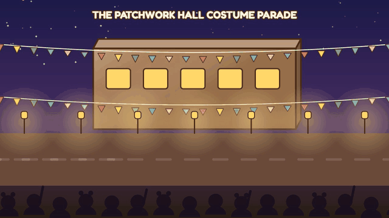

---

## 1. Before

| | |
|---|---|
| 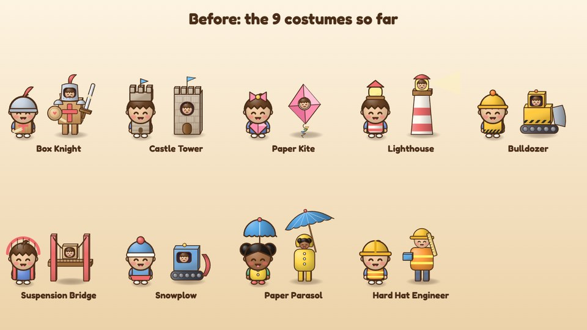 |  |
| The 9 costumes so far, each shown as walking outfit → battle form. | The "Cardboard up!" moment: costumes grew into battle forms with a puff of cardboard, but it went by fast. |

## 2. Designing two new costumes

| First pass | Second pass |
|---|---|
| 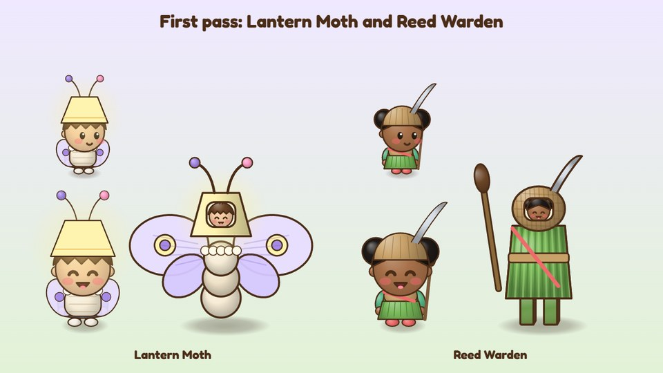 | 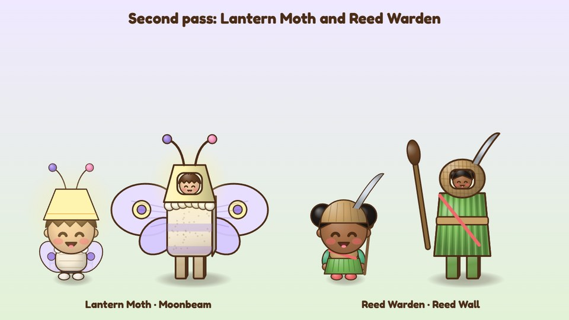 |
| **Lantern Moth** (left): paper wings, a glowing lampshade hat, felt antennae. The battle form's body was three stacked balls and read as a snowman. **Reed Warden** (right): a woven reed skirt, a heron-feather cap and a cattail staff, with a basket helmet and the wearer's face in the window. It worked first time. | The moth's body became a fuzzy striped cardboard box on two cardboard legs, with a lace ruff. Now it's clearly a costume a kid made, which is the Costume Quest rule: homemade becoming magnificent. |

| Costume | Battle special | Out in the world |
|---|---|---|
| Lantern Moth | **Moonbeam**: shows every foe's next move, marks a weak spot on all of them, mends the party a little | Glows like the Lighthouse: brighter nights, and hidden boxes show up |
| Reed Warden | **Reed Wall**: a wall of reeds soaks up the next 3 water attacks, dries everyone, mends a little | Wade through shallow water |

## 3. Pieces come from friends

| | |
|---|---|
| 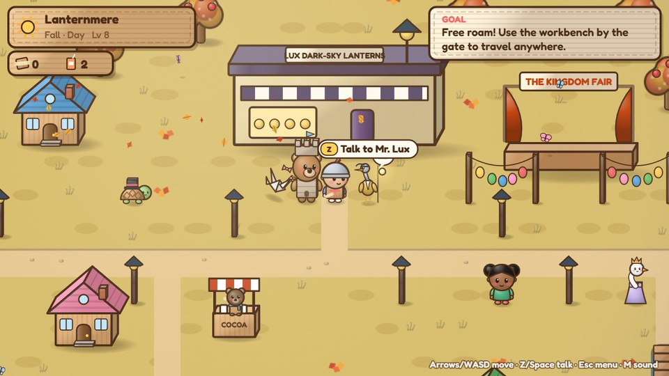 | 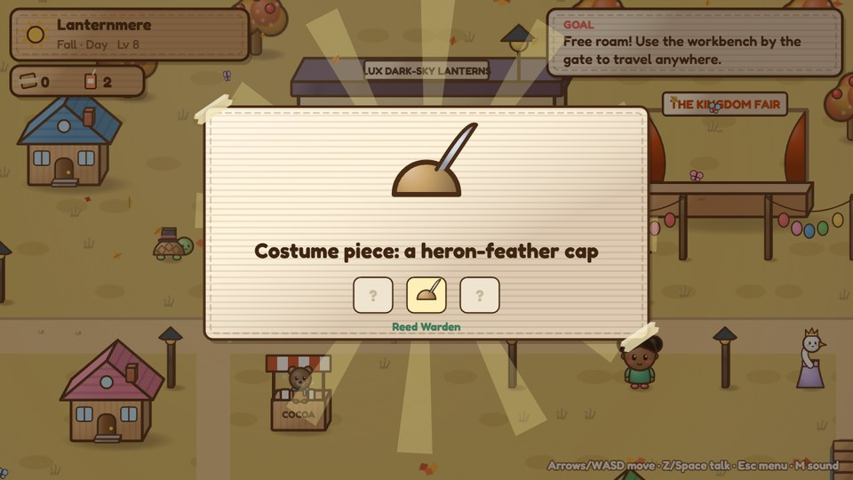 |
| Once a place is saved, a little sparkle bubble with the piece in it floats over whoever has one for you. | Each piece shows its costume's three slots, so you always know what's left. |

| Lantern Moth | Reed Warden |
|---|---|
| Paper wings from **Elder Dusk** (Lanternmere): "folded from the old lantern paper" | A reed skirt from **Mallow** (Ferryyard): "it took eleven trips" |
| A lampshade hat from **Ibis**: her desk lamp of twenty years | A heron-feather cap from **Mr. Lux** |
| Felt antennae from **Tansy** (different lengths, "on purpose. Not on purpose.") | A cattail staff from **Old Tin**, from the dunes where the living shoreline grew |

## 4. Tansy sews them

| | |
|---|---|
| 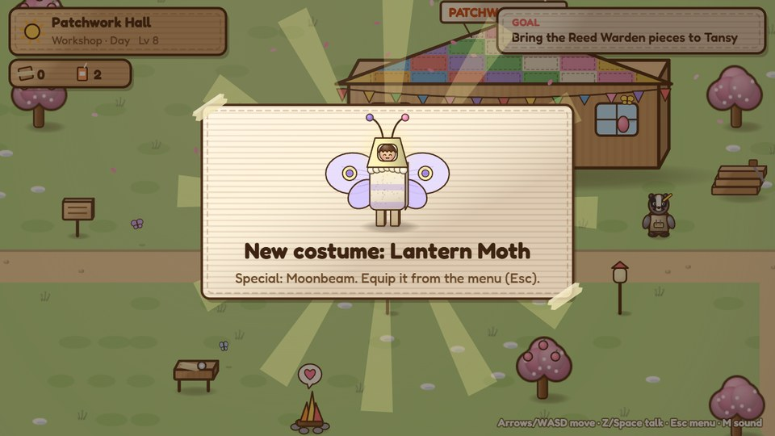 | 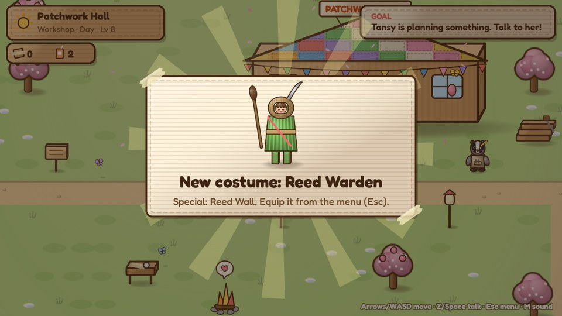 |
| "Don't watch my face, I make a face." | "The skirt rustles when you walk. It sounds like a river being polite." |

## 5. In battle and in the world

| | | |
|---|---|---|
| 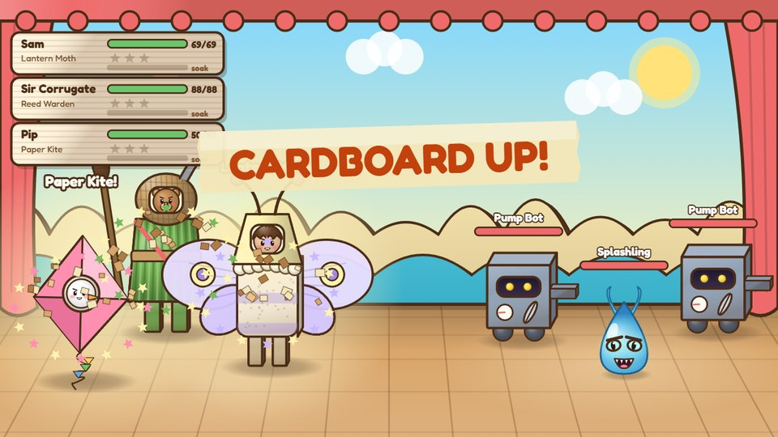 | 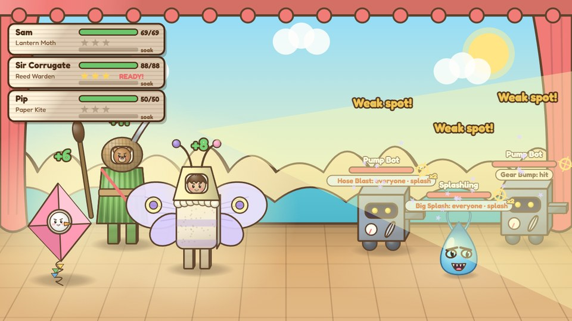 | 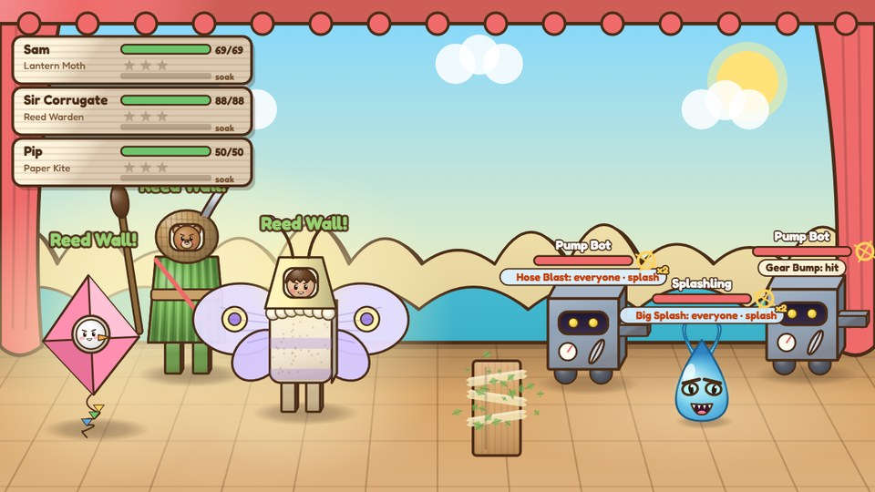 |
| **Brighter transformation (every battle):** a pop of light, a ring of stars in the costume's colors, and the costume's name over each hero. | Moonbeam: every foe gets a weak spot and shows its move. | Reed Wall: the reeds take the next 3 splashes. |

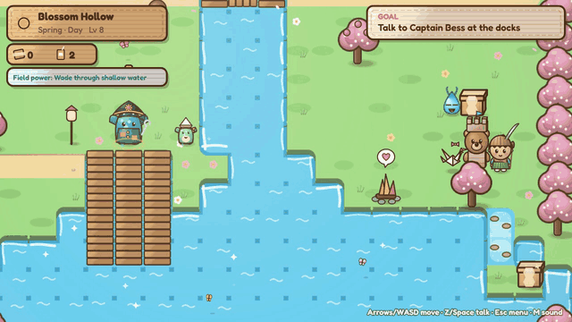

The Reed Warden can wade through shallows, like the Suspension Bridge. Here it's crossing to Blossom Hollow's island chest.

## 6. The Costume Parade

| | |
|---|---|
| 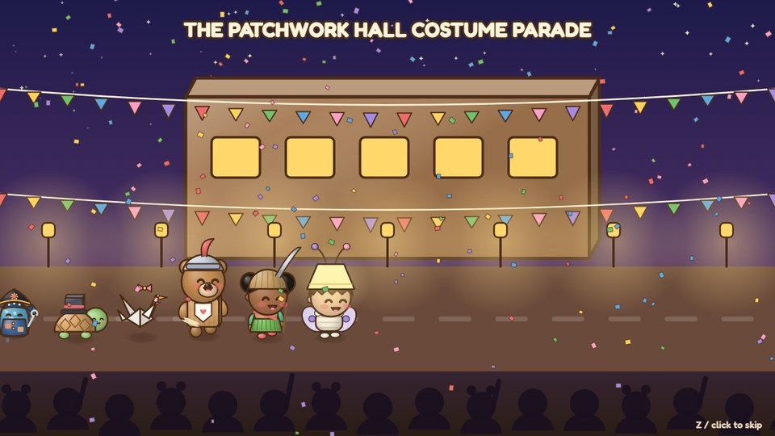 | 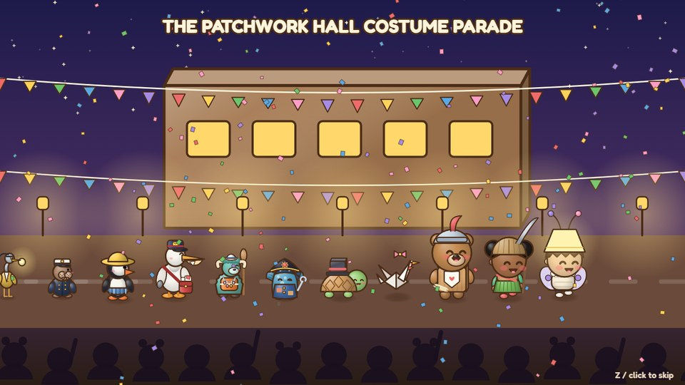 |
| Once a new costume is sewn, Tansy throws a parade that night. Bunting, porch lanterns, confetti and a cheering crowd. | Everyone you've met marches past: Mayor Mossworth, Captain Bess, Mallow, Pell, Keeper Gale, Brack, Mr. Lux, Rook, Ibis, Grandpa Wick, Grandma Rosie and Tansy. |

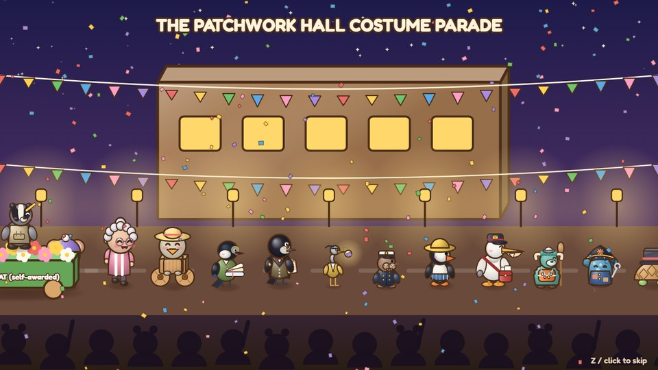

Brindle's flower float brings up the rear, labeled BEST FLOAT (self-awarded). Best costume? "Everyone. That's the rule. I made it up."
