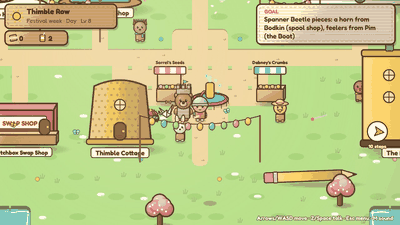
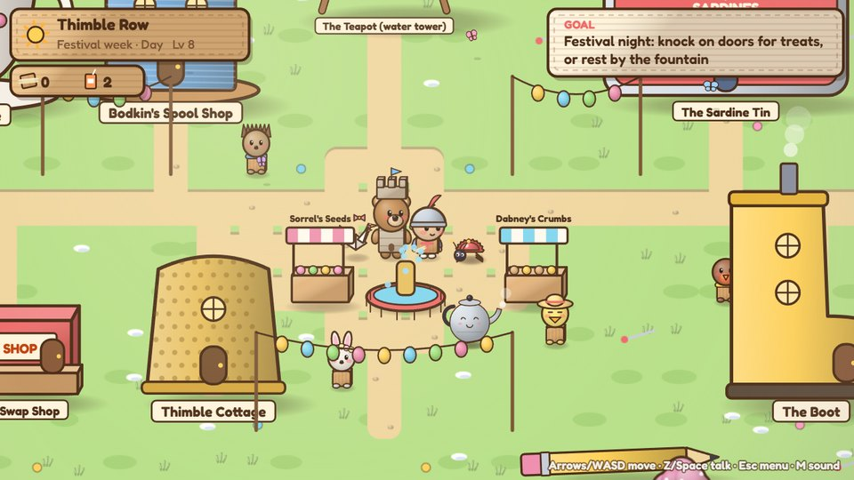
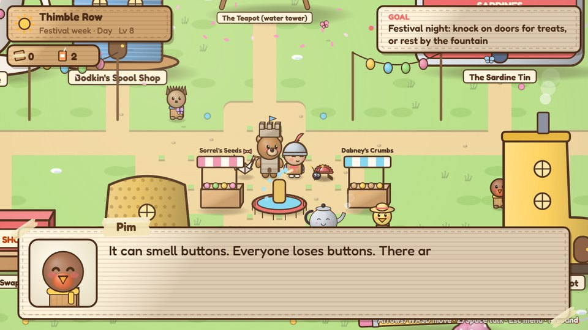
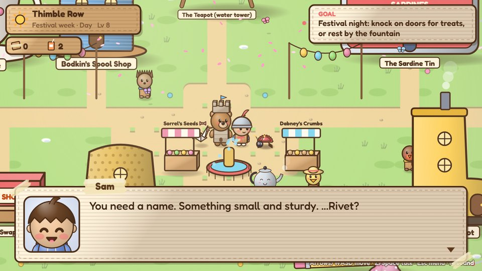
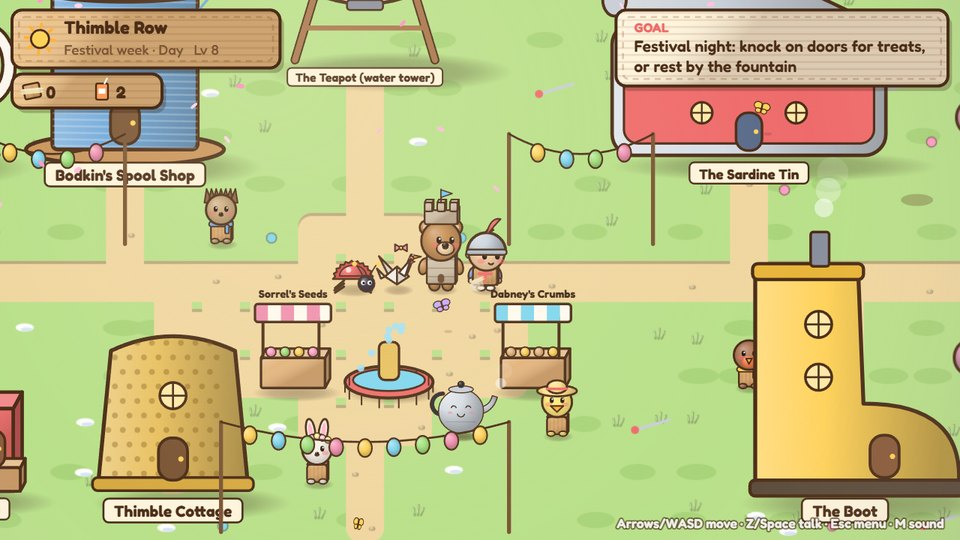
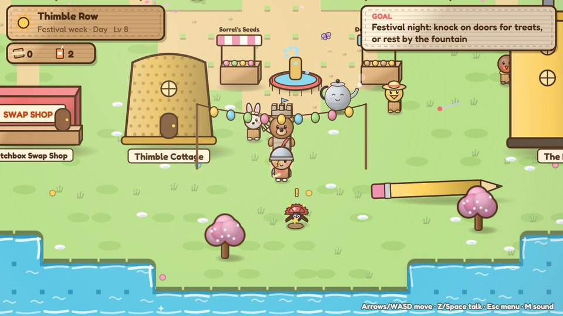
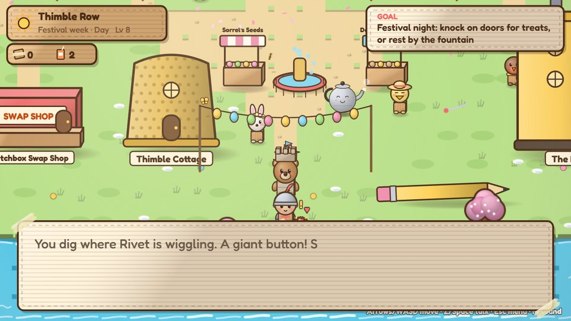
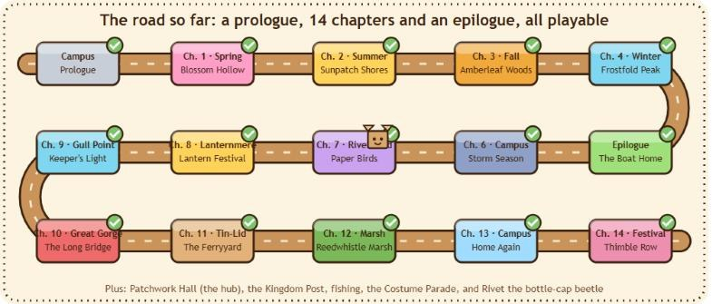

# How v2.15 "Rivet, and the road so far" was built

Every image is a capture from the real game while it was being built, in order.

**This round** had two jobs: the game gets the companion idea from the inspiration atlas (attachment, following, a useful ability), and the project gets a brand-new GitHub home with a README that shows how far the game has come, using animated clips recorded from the current build.

| Rivet finds a button |
|---|
|  |

---

## 1. Meeting Rivet

| | | |
|---|---|---|
|  |  |  |
| After the Thimble Row festival, a little bottle-cap beetle waits by the fountain. | Pim explains: bottle-cap beetles pick one person, and they can smell buttons. You choose whether to bring it along ("Not yet" is fine too). | Sam names it Rivet. |

## 2. Following, sniffing, digging

| | | |
|---|---|---|
|  |  |  |
| Rivet trots behind the party in every place in the Kingdom (and waits by the box when Sam goes home). | Two buttons are buried in every place. When you get close, Rivet runs off to the spot, wiggles, and a **!** pops up. Only then does the mound show. | Dig: a giant button and scraps. Rivet has something to say every time, and Pim has something to say at five. |

The first version of the follower froze the whole party: the update hook dropped the "is this scene active?" argument, so the game thought a cutscene was always running. Found during the keyboard play-through, fixed before release.

## 3. The README: the road so far

| First pass of the animated progress map |
|---|
|  |
| A winding cardboard road through the prologue, all 14 chapters and the epilogue. It draws itself, each stop pops in with a check, and a little cardboard box travels the whole road. The first pass had the chapters numbered wrong (there is no Chapter 5: it's the epilogue), and the long names overflowed their tiles. |

The README now opens with a reel of the Kingdom, the progress map, and a grid of 15 short clips, one for every place, recorded from this build. Lower down: the engineering puzzles in motion, and a table of every version with a picture of what it added.

Clips live in [docs/media/readme](../../readme/): `hero.gif`, one GIF per place, `battle.gif`, `rivet.gif`, and `progress.svg`.
