# v2.17: the Kingdom Post redesign

 &nbsp;[Play 2.17.0](https://normansrule.github.io/cardboard-kingdom/versions.html#v2.17.0) · [Play the newest](https://normansrule.github.io/cardboard-kingdom/play.html)

**1. Three concepts.** Each was rooted in what the game is about, and Alek picked C.

| A · Model Shop | B · Pop-up Book | C · Kingdom Post |
|---|---|---|
| 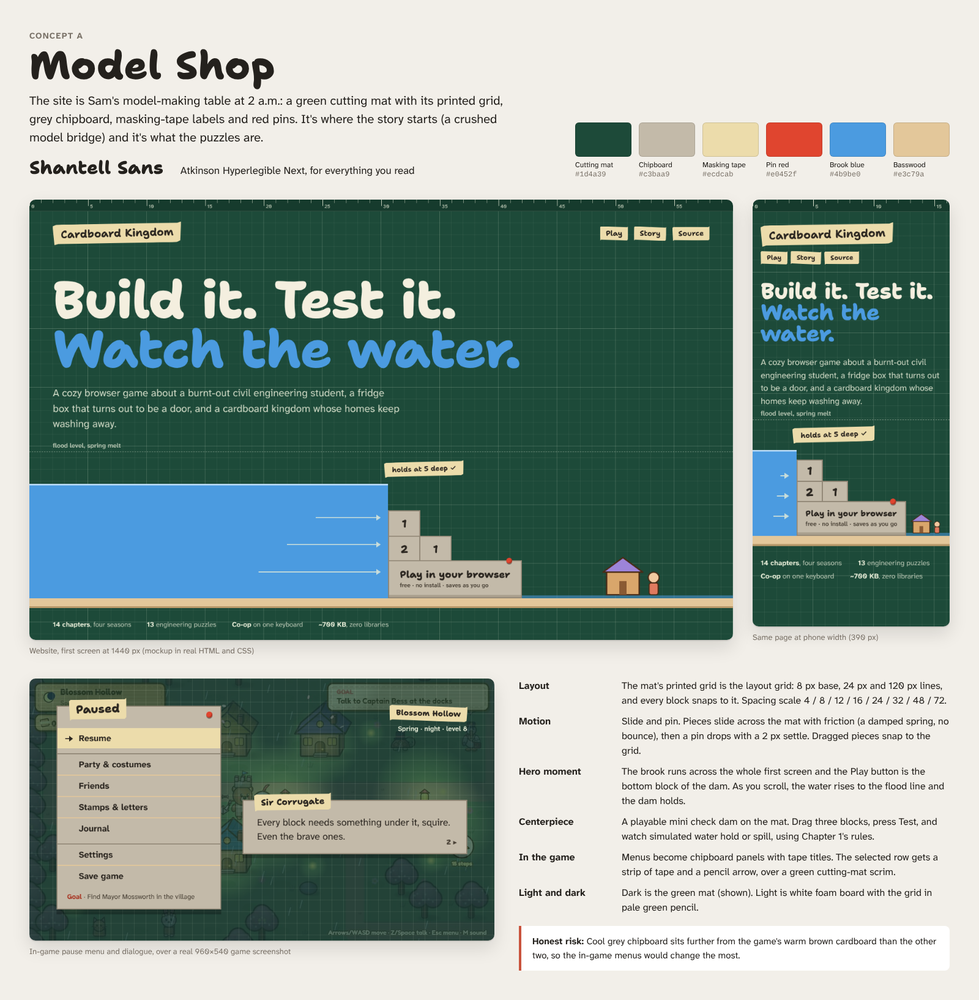 | 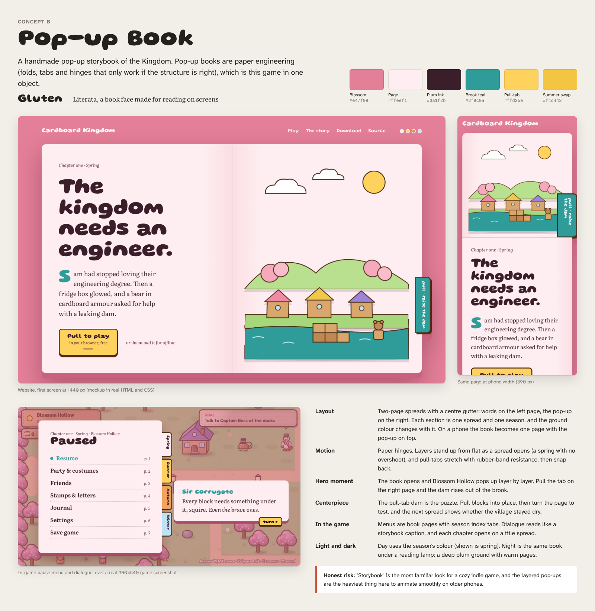 | 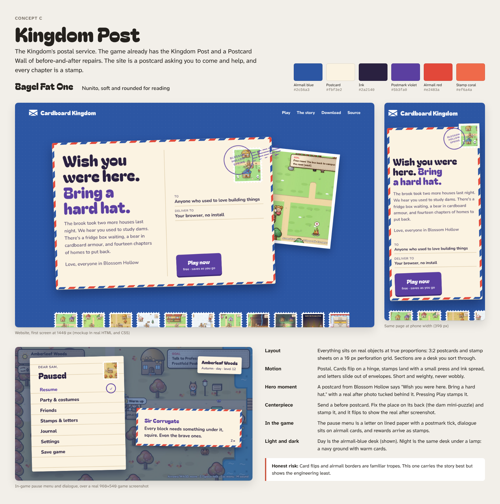 |

**2. The website's centerpiece, the postcard dam.** Here it leaks, then holds and gets stamped, then flips to the real puzzle.

| Leaked | Held | Flipped |
|---|---|---|
| 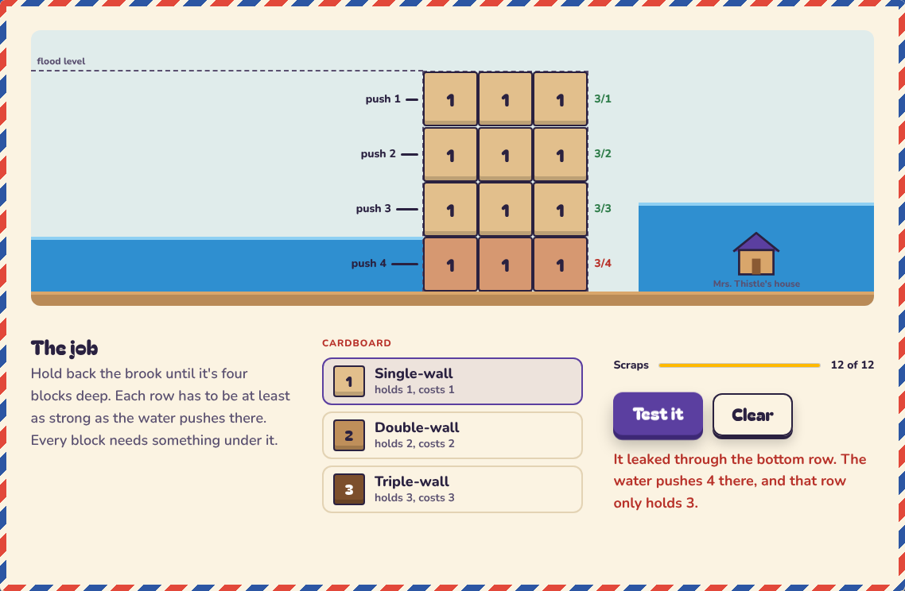 | 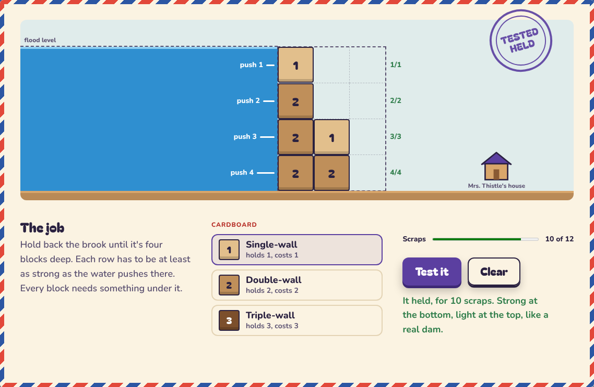 | 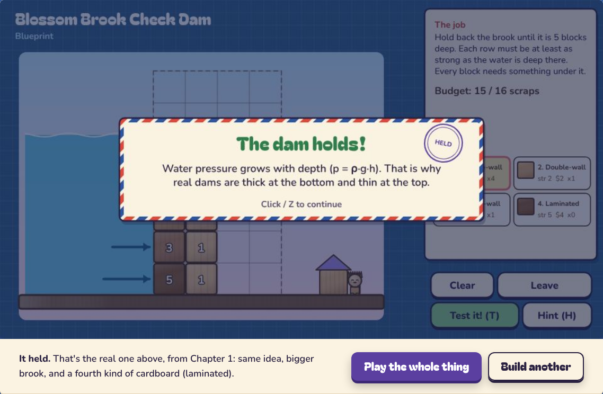 |

**3. Play page states.** Loading, error, and no JavaScript.

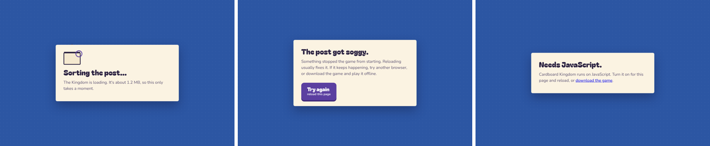

**4. The full website.** Day desk, 1440 pixels wide.

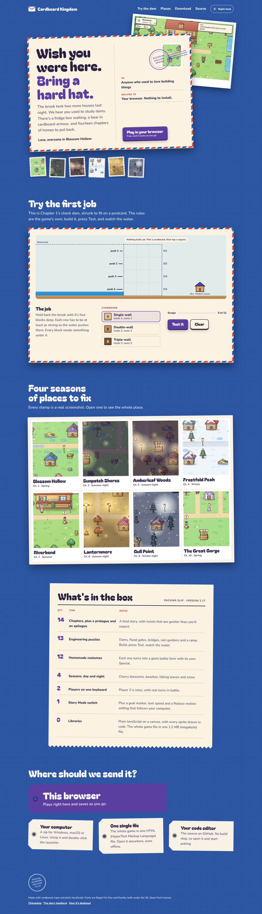

**5. Character pass.** Alek asked for a cuter, cooler cast in the same direction. Bigger heads, sparkle eyes, soft blush, and one signature piece each.

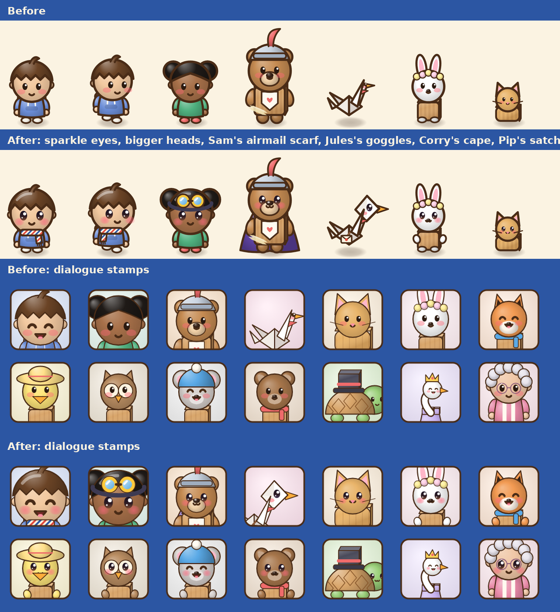

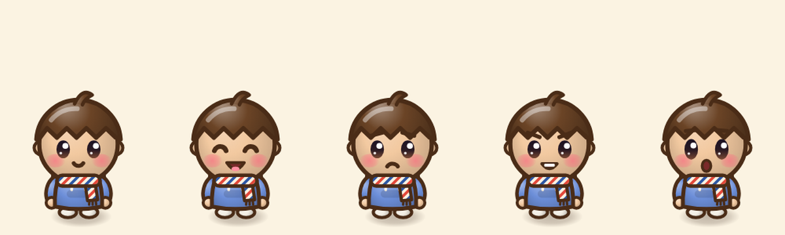

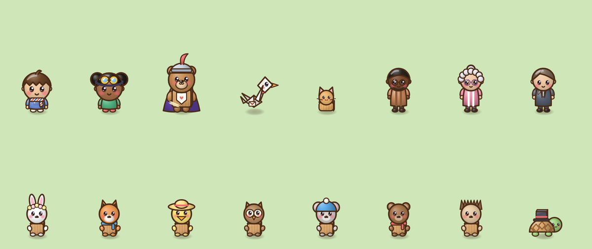
