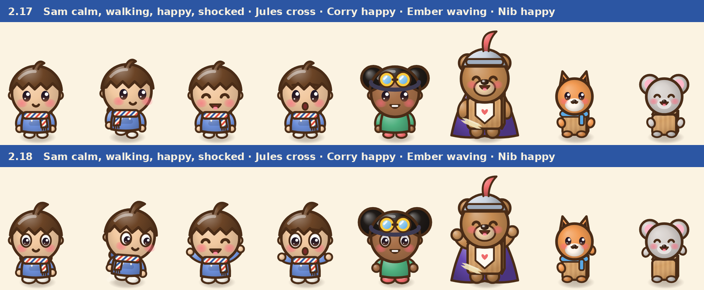
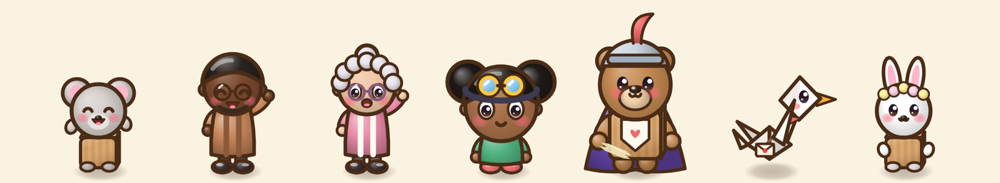
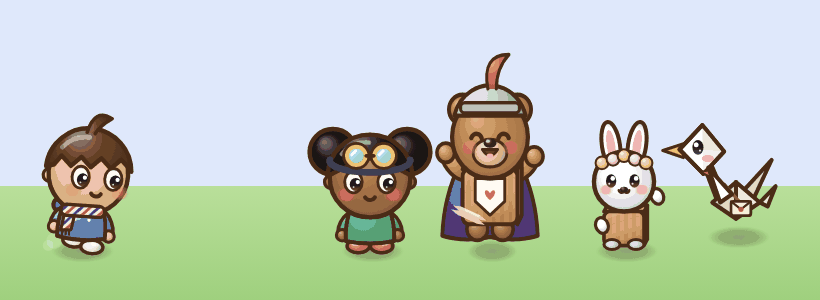
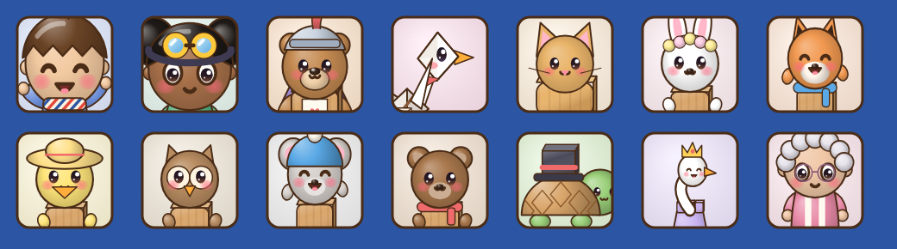

# v2.18: a livelier cast

 &nbsp;[Play 2.18.0](https://normansrule.github.io/cardboard-kingdom/versions.html#v2.18.0) · [Play the newest](https://normansrule.github.io/cardboard-kingdom/play.html)

Alek asked for characters that are more interesting and dynamic, with Kirby, Pikachu, Togepi, Chao, Yoshi, Om Nom, Mario, Pac-Man and Costume Quest as references. What we took from them: big readable eyes that point somewhere, open happy mouths, arms that do something, chunky feet, and a body that squashes and stretches.

**1. Before and after.** The same moods in 2.17 and 2.18. Kids get Costume Quest eyes (whites and pupils), and every mood gets a pose.

**2. The rest of the cast.** Grown-ups wave instead of cheering, critters hold their paws up, and Pip keeps flapping.

**3. In motion.** Sam walks and kicks up dust, Jules glances around, Sir Corrugate cheers, Clover waves.

**4. Dialogue stamps.** The speaker's stamp now moves its mouth while the line types out.

