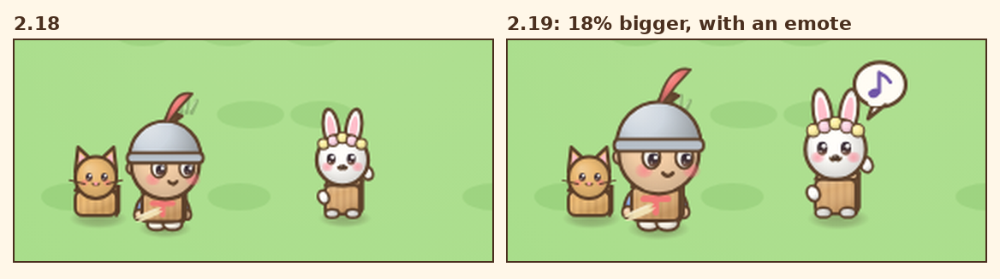
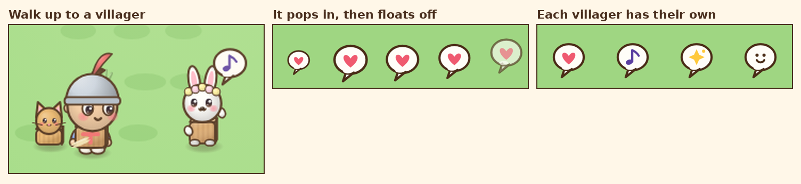
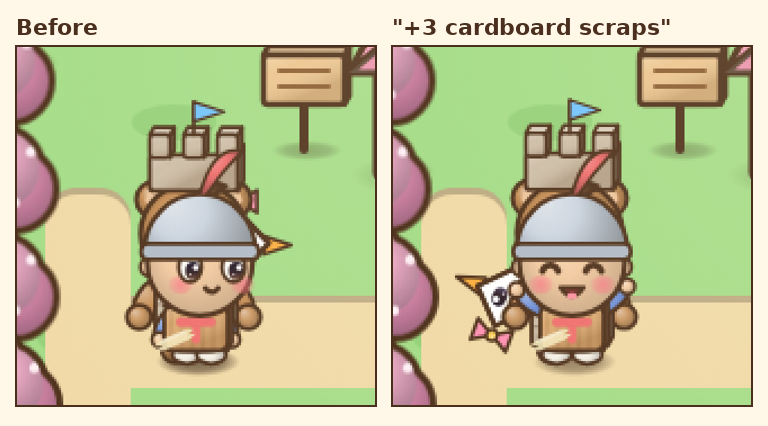

# v2.19: friendlier on the map

 &nbsp;[Play 2.19.0](https://normansrule.github.io/cardboard-kingdom/versions.html#v2.19.0) · [Play the newest](https://normansrule.github.io/cardboard-kingdom/play.html)

Alek asked to keep building and refining. 2.18 gave the cast faces and poses, but on the map, where you spend most of the game, the characters were small enough that it was hard to see. So this round is about the map: bigger characters, villagers who greet you like Animal Crossing neighbours, and a Sam who reacts.

**1. A size up.** The same spot in 2.18 and 2.19. Everyone on the map is 18% bigger, so the Costume Quest eyes and blush read from across the village.

**2. Greeting emotes.** Walk up to a villager and a bubble pops in with a little overshoot, then floats up and fades. Each villager has their own emote (heart, note, sparkle or smile), so you start to know them by it.

**3. Sam cheers.** Good news, like picking up cardboard scraps, makes Sam face you and throw their arms up for a moment.

