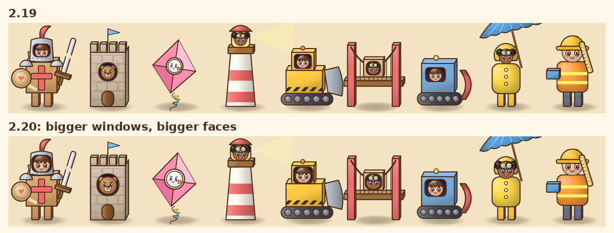
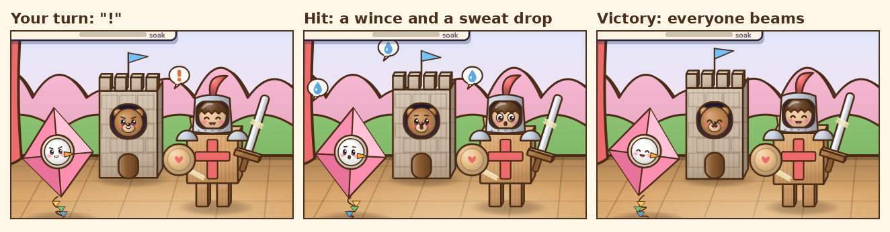
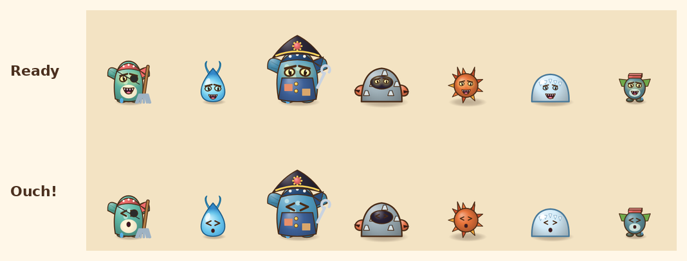

# v2.20: who's inside the costume

 &nbsp;[Play 2.20.0](https://normansrule.github.io/cardboard-kingdom/versions.html#v2.20.0) · [Play the newest](https://normansrule.github.io/cardboard-kingdom/play.html)

Alek asked to keep building. The best thing about Costume Quest is seeing the kid inside the homemade costume, and in our battles that face was small and never reacted. This round makes the kids visible and lets everyone on stage react.

**1. Bigger windows, bigger faces.** Every costume in 2.19 and 2.20. The visor, arch, cabs, hut and lantern are wider, and the face behind is about 20% bigger.

**2. Reactions.** A "!" pops up over whoever's turn it is. A hit makes the kid inside wince with a sweat drop, and a win makes everyone beam and bounce.

**3. Monsters say ouch.** When a hit lands, monsters squeeze their eyes shut for a moment, then go back to scowling.

