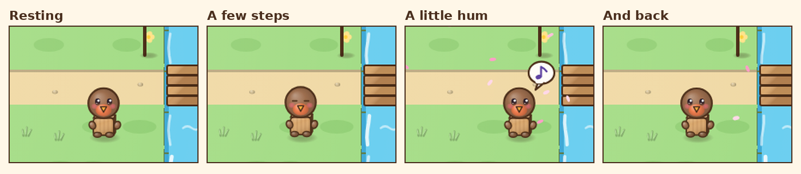
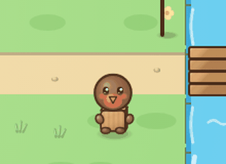
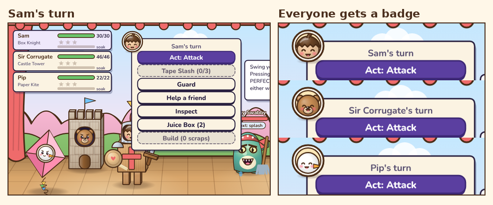

# v2.21: villagers potter about

 &nbsp;[Play 2.21.0](https://normansrule.github.io/cardboard-kingdom/versions.html#v2.21.0) · [Play the newest](https://normansrule.github.io/cardboard-kingdom/play.html)

Alek asked to keep building. Two things stood out after 2.20. On the map, villagers only came alive when you walked up to them, but Animal Crossing neighbours are always doing something. In battle, the turn menu sat over Sam's knight, hiding the face we had just made bigger.

**1. Pottering.** Villagers with room around them take a few steps, rest, hum (about half of them do), and wander back. The one your goal arrow points at waits for you.

**2. A badge on your turn.** The battle menu wears a round badge with the face of whoever's turn it is. It replaces 2.20's "!" bubble, which could look like it belonged to the costume next door.

