# v2.22: a kingdom with things to do

 &nbsp;[Play 2.22.0](https://normansrule.github.io/cardboard-kingdom/versions.html#v2.22.0) · [Play the newest](https://normansrule.github.io/cardboard-kingdom/play.html)

Alek said the world was too simple and open-ended, and asked for more detail, more to do, challenges and skins to buy, with retention that's healthy and no microtransactions. Alek pointed at ten world-building repos. The 2D ones (WaveFunctionCollapse, Azgaar's map generator, mapgen4, THREE.Terrain, ProceduralDungeon) shaped a small world generator; the 3D engine ones were inspiration only. Credits and licenses are in [docs/PLAYTIME.md](../../../PLAYTIME.md).

**1. Places laid out by a generator.** Each image is the old version on the left and 2.22 on the right. Moisture and lushness fields decide the biomes, a wave function collapse pass picks tall grass, reeds, hedges, stumps and flower beds, and every house gets a front yard. Signposts stand at the crossroads, and landmarks sit in quiet corners with stepping-stone trails leading to them.

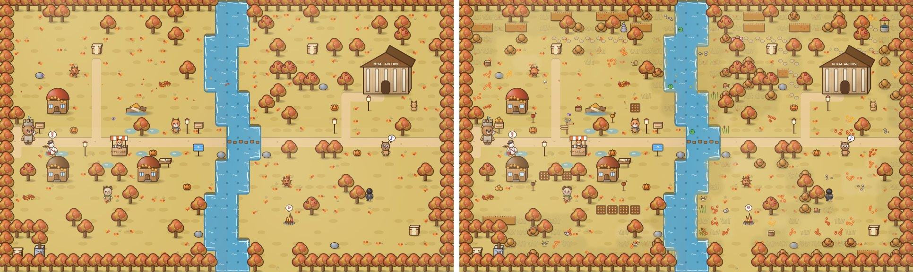
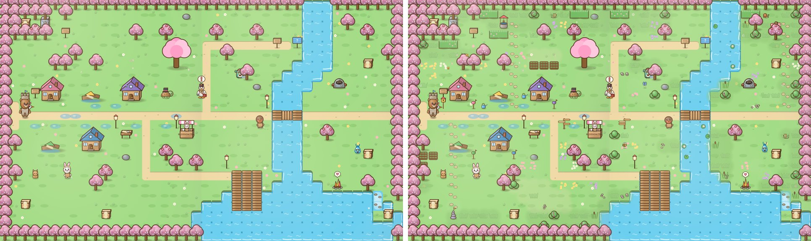
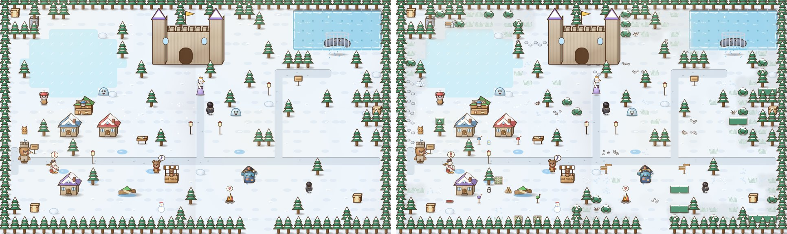
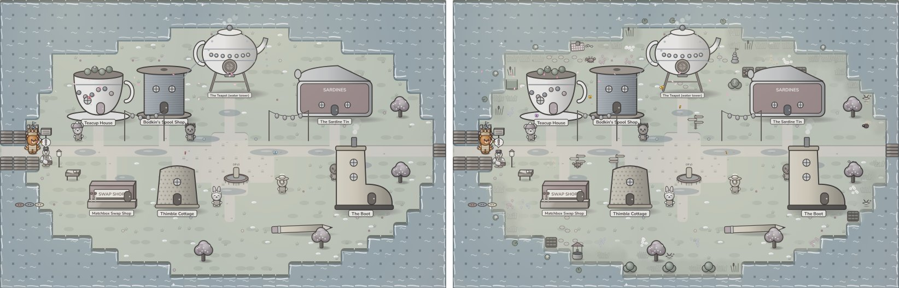
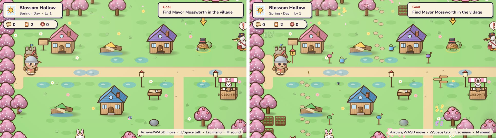
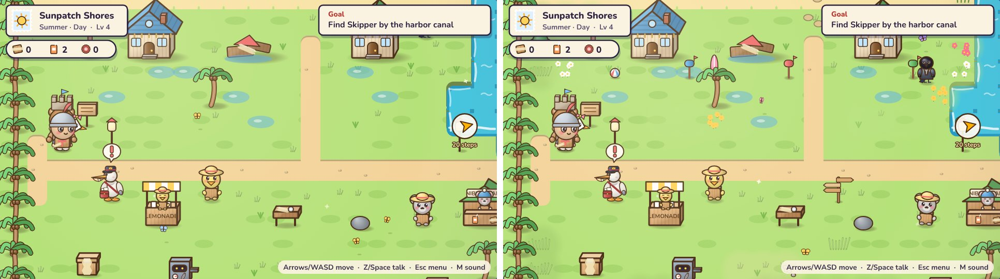
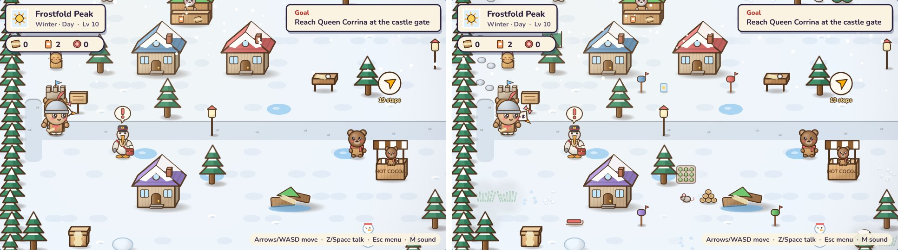

**2. Things to find.** Critters to sketch for the Field Guide, paper cranes that carry wishes, and lookouts that show a map of the place.

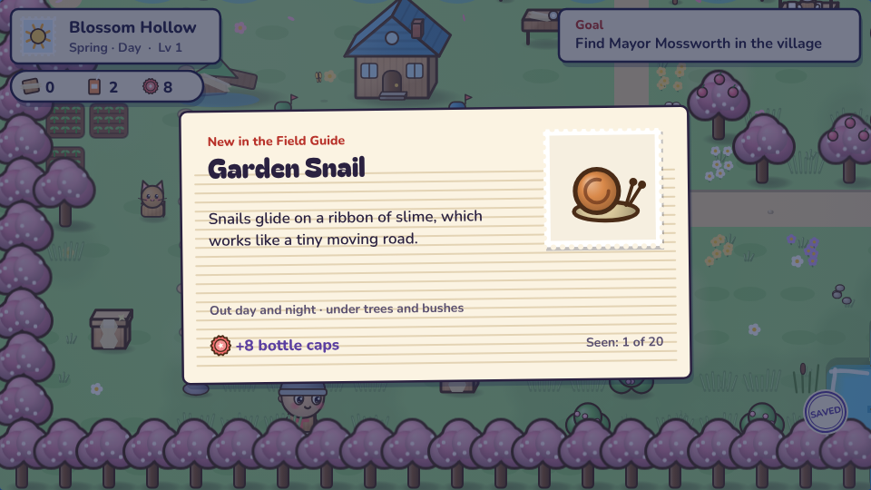
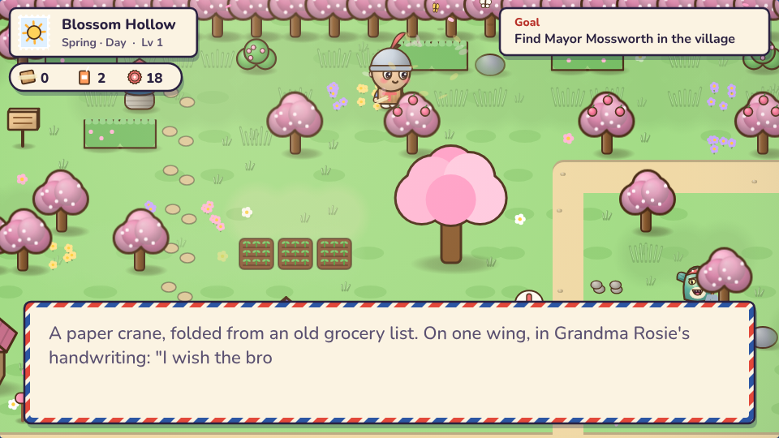
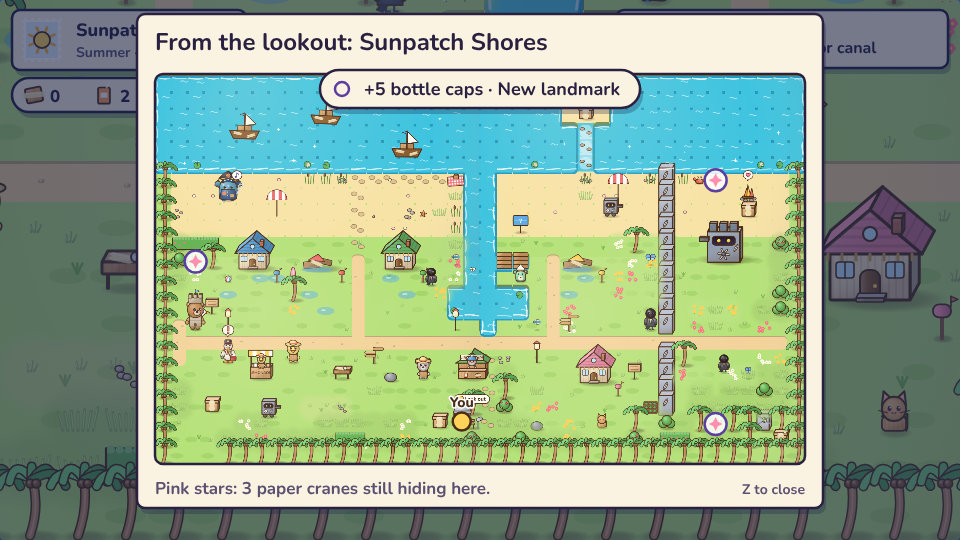

**3. The Kingdom Book.** Odd Jobs that never expire, challenges with bronze, silver and gold tiers, the Field Guide, and Places.

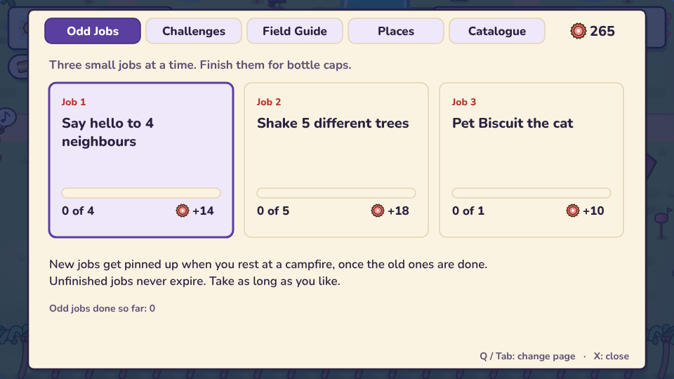
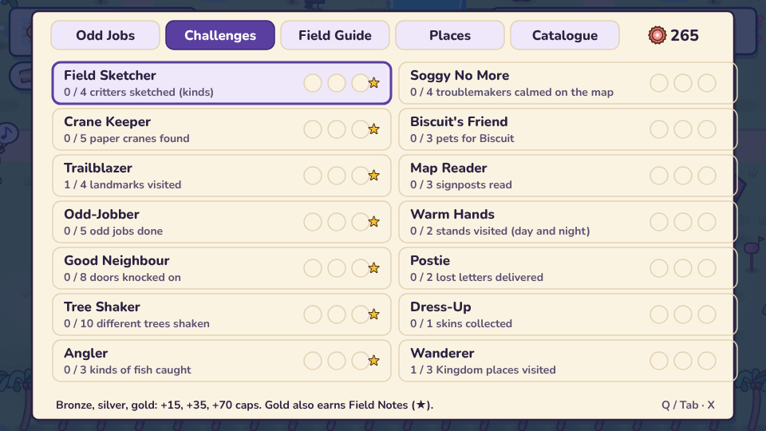
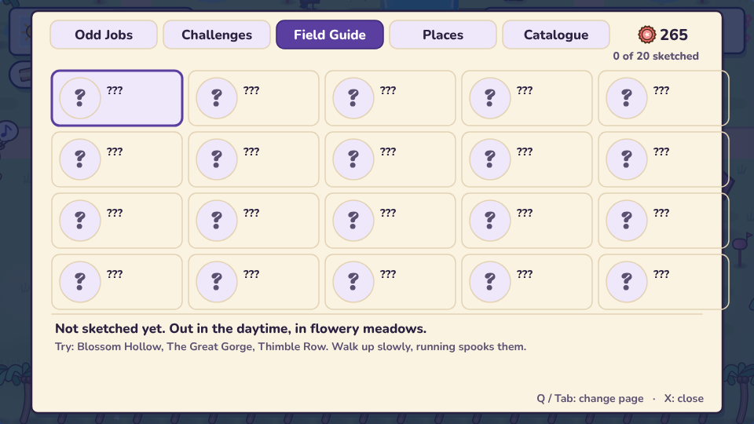
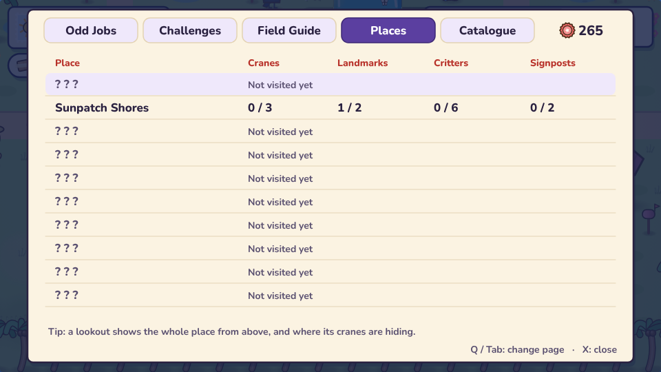

**4. The Catalogue.** Paints and hats bought with bottle caps you earn by playing. A paint covers the costume and the giant but never the face.

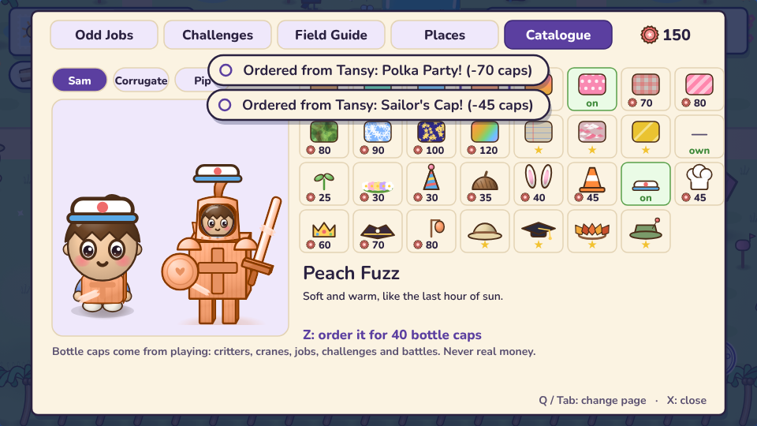
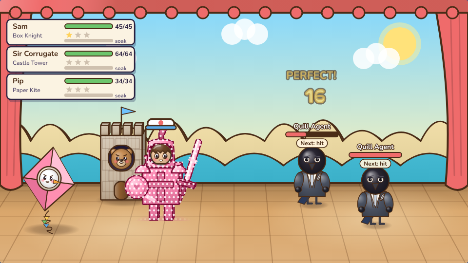

**5. Fair play.** No real money, no streaks, nothing that expires. The break reminder can be set in Settings.

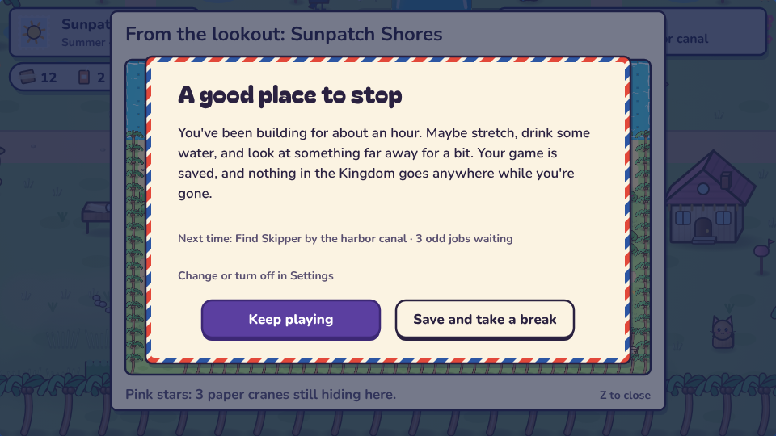
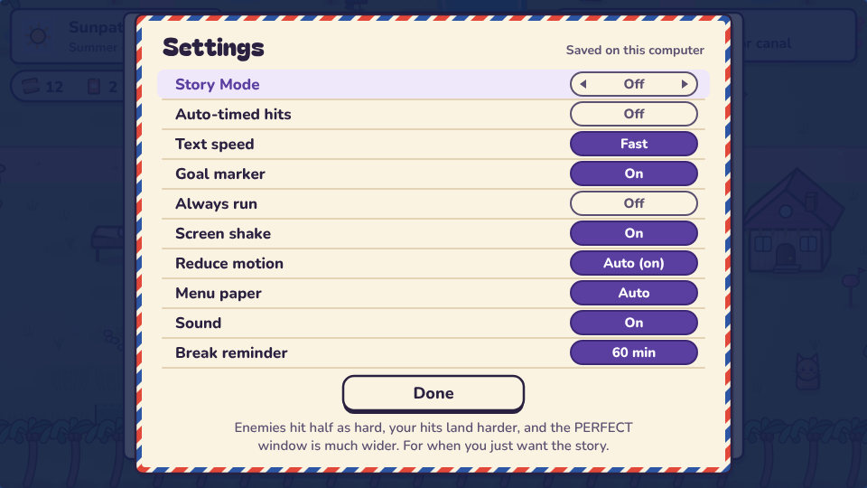
