# v2.23: treasure and a patch of your own

 &nbsp;[Play 2.23.0](https://normansrule.github.io/cardboard-kingdom/versions.html#v2.23.0) · [Play the newest](https://normansrule.github.io/cardboard-kingdom/play.html)

Alek asked to keep building: more world depth, more to do, and more skins to earn, with no microtransactions. 2.22 gave every place things to find once. This round adds two reasons to come back, both from Animal Crossing: a garden that's yours, and treasure maps.

**1. Your patch.** The world generator leaves a 5 by 3 plot of open lawn by a road in Blossom Hollow. It was Grandma Rosie's garden. On the left is the empty patch, and on the right the same spot after decorating, with three visitors.

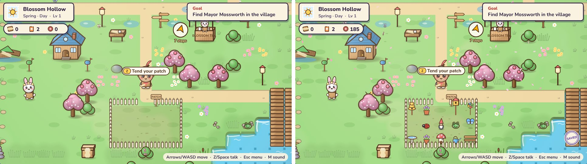

Press Z at the gate to decorate. The camera glides over the patch, and a tray shows the garden pieces you own and which critters like each one.

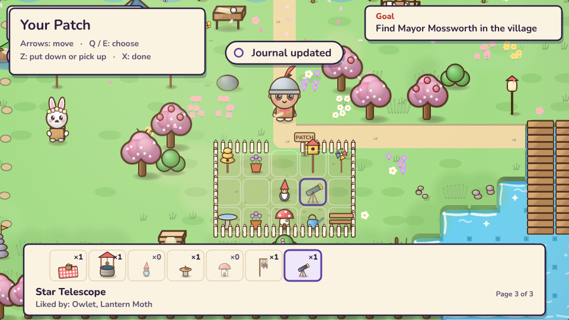

Critters you've sketched visit when the patch has something they like. Night critters come at night, and lanterns glow.

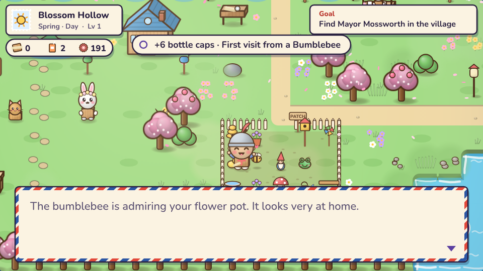
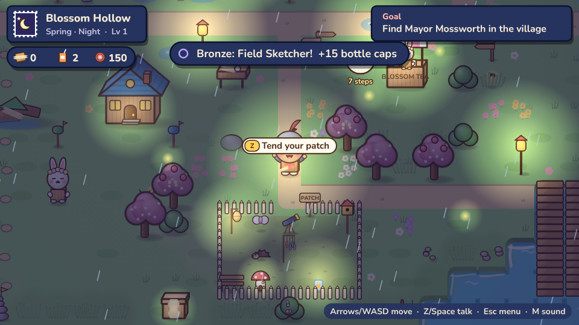

**2. Buried treasure.** Two per place. The map scraps are behind signposts and at landmarks. Each one is drawn from the real spot, faded to old paper, with a red X and a hint.

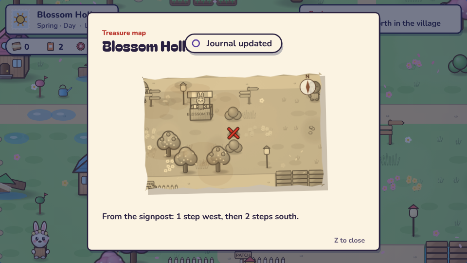
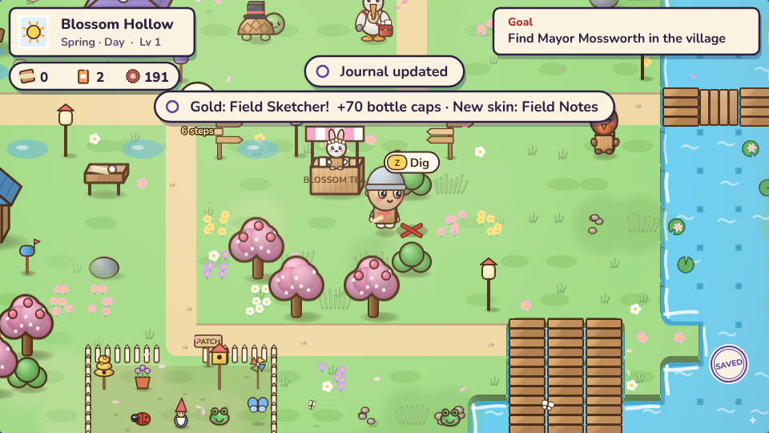
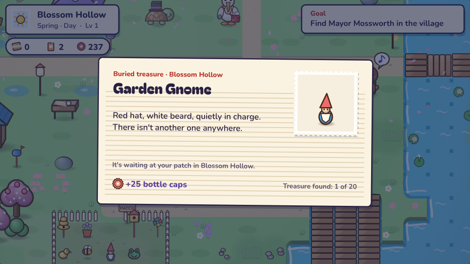

**3. The Kingdom Book.** A Garden page to order pieces, a fuller Catalogue, three new challenges, and treasure on the Places page.

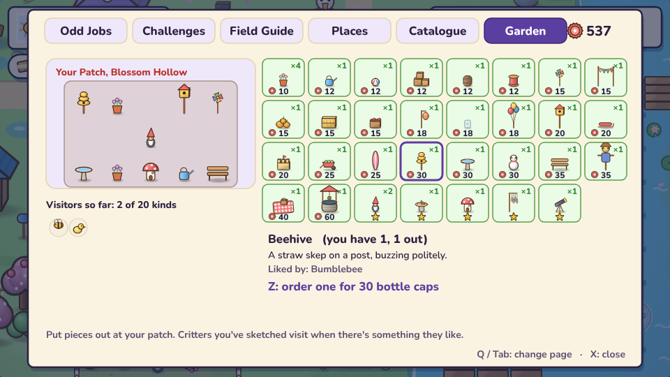
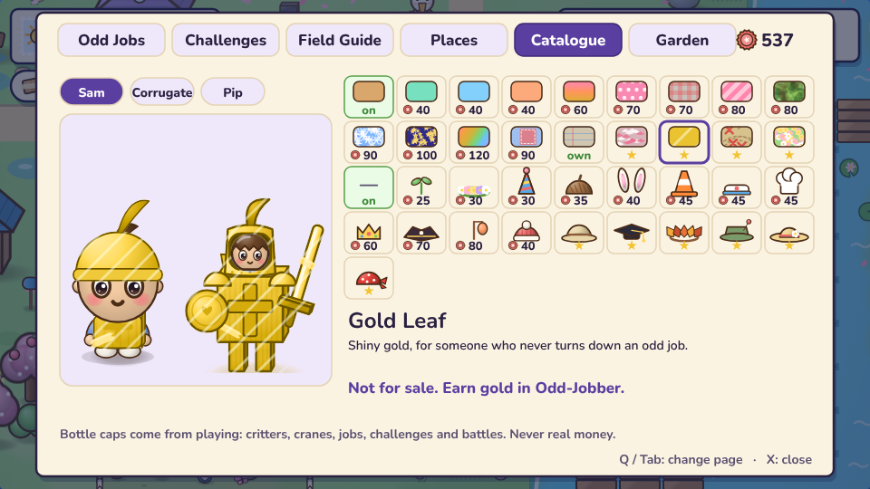
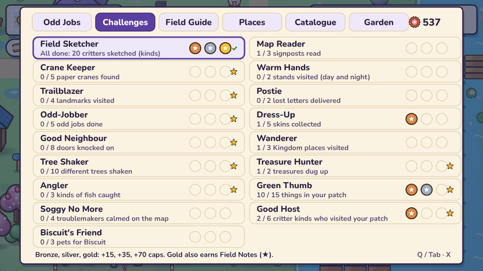
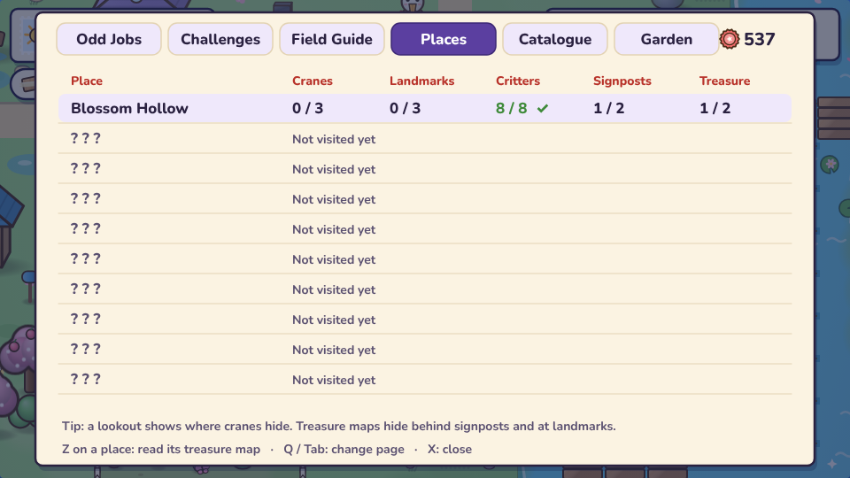
