# v2.24: neighbors you care about

 &nbsp;[Play 2.24.0](https://normansrule.github.io/cardboard-kingdom/versions.html#v2.24.0) · [Play the newest](https://normansrule.github.io/cardboard-kingdom/play.html)

Alek asked for characters that are cuter and more stylish, like Costume Quest, Terraria or Stardew Valley, where people can relate to the characters and care about them. Alek also shared some reference repos. The narrative and art-bible templates in Claude Code Game Studios and the canon rules in worldcodex were used as checklists for this round. The art and writing rules are now in [ART_BIBLE.md](../../../ART_BIBLE.md).

**1. Signature looks.** Before this round, the villagers were the same little critter with a different hat. Now each one carries something you can spot from across the map. In each row, 2.23 is on the left and 2.24 on the right: Bristle's rake, Robin's mail bag, Ember's sketchbook and Mama Burrow's knitting.

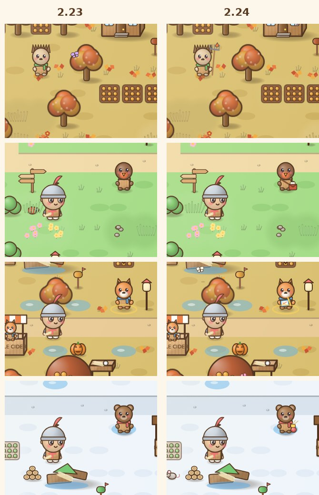

**2. Hearts and presents.** Talk to a neighbor and you can give them a present from your spare garden pieces. Everyone loves three things, and the hint tells you what kind.

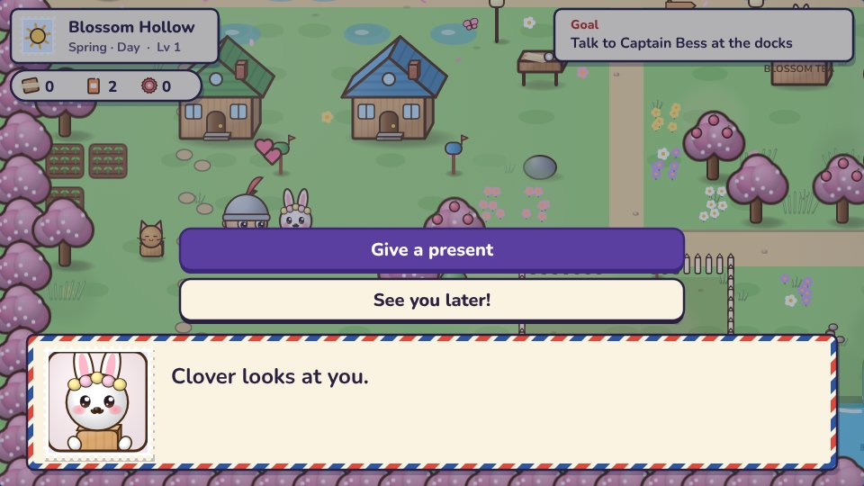
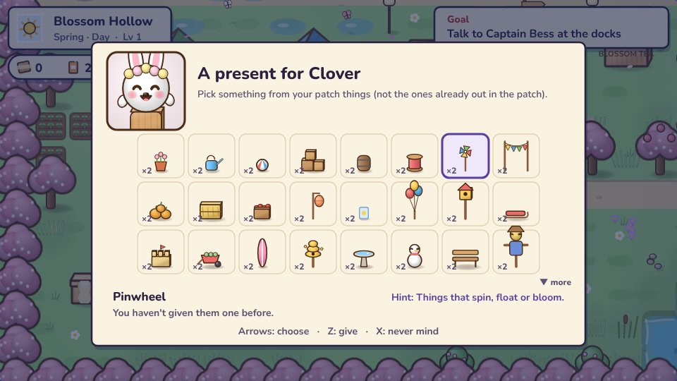
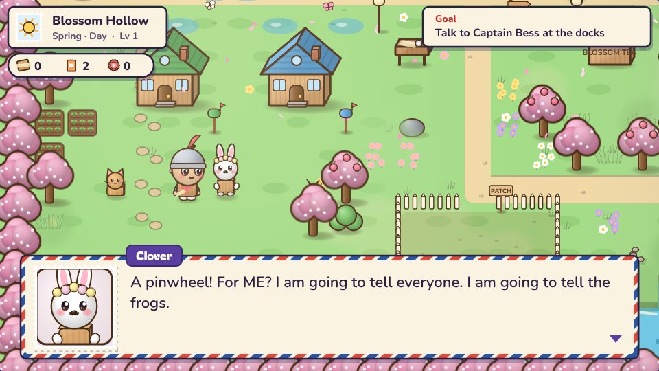

**3. Heart stories.** A heart floats over anyone with a story ready. At one, three and five hearts each neighbor shares something ordinary and real, and at five hearts they do the brave thing themselves.

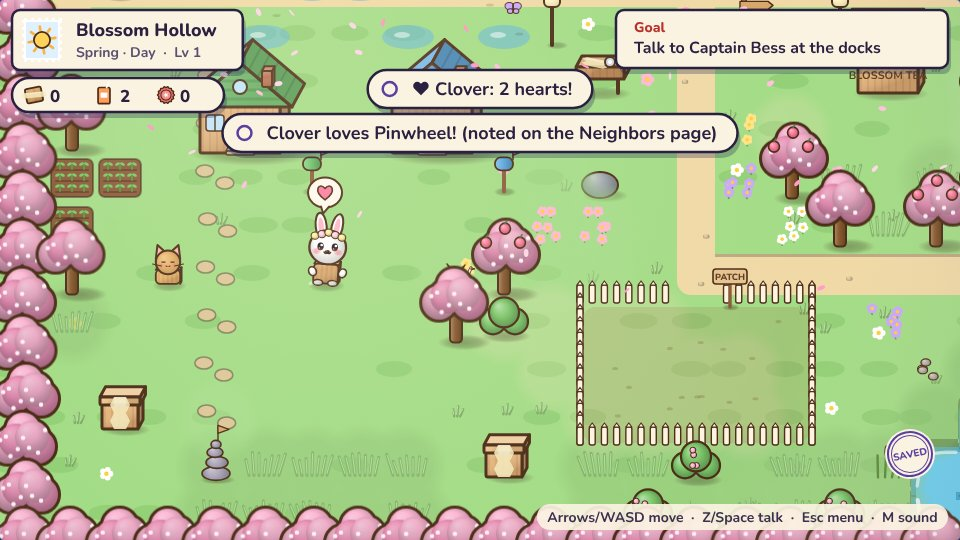
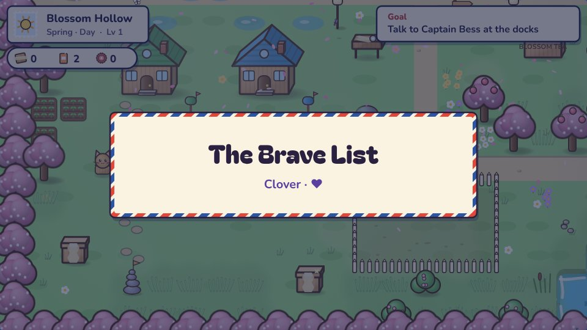

**4. Keepsakes.** Every five-heart story ends with a hat you can't get anywhere else. Clover's looks change too: after her last story she carries her own pink lantern.

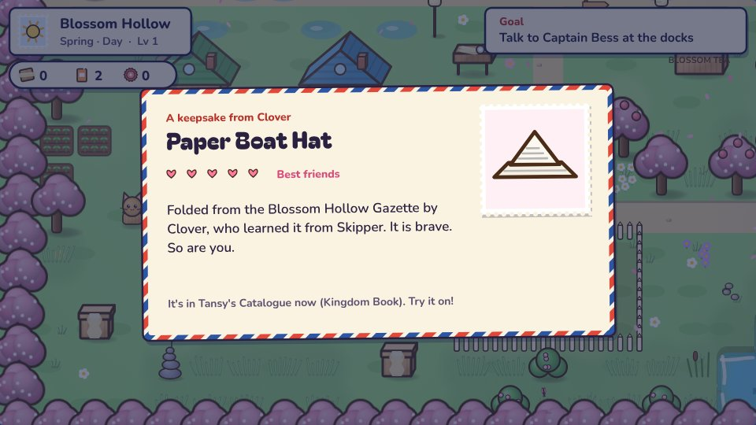
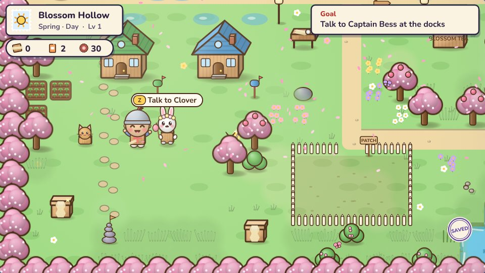

**5. The Neighbors page.** In the pause menu: wants, fears, quirk, a secret at three hearts, what they love, and their stories, which you can read again.

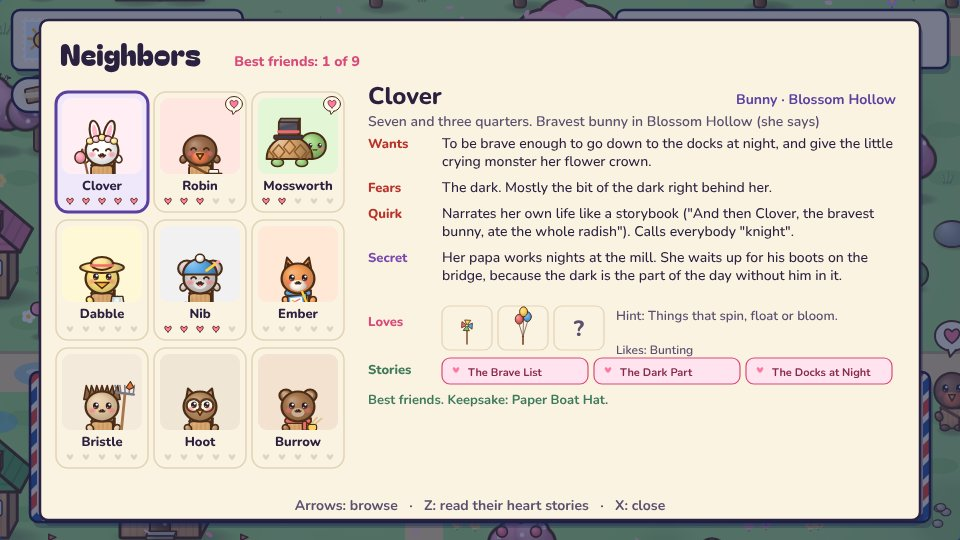
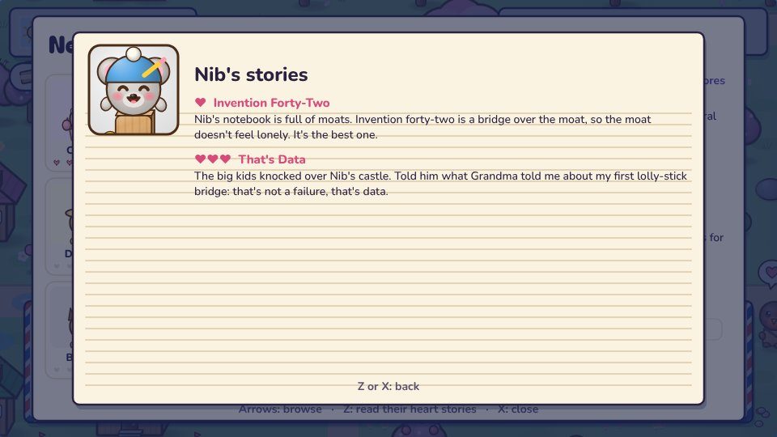
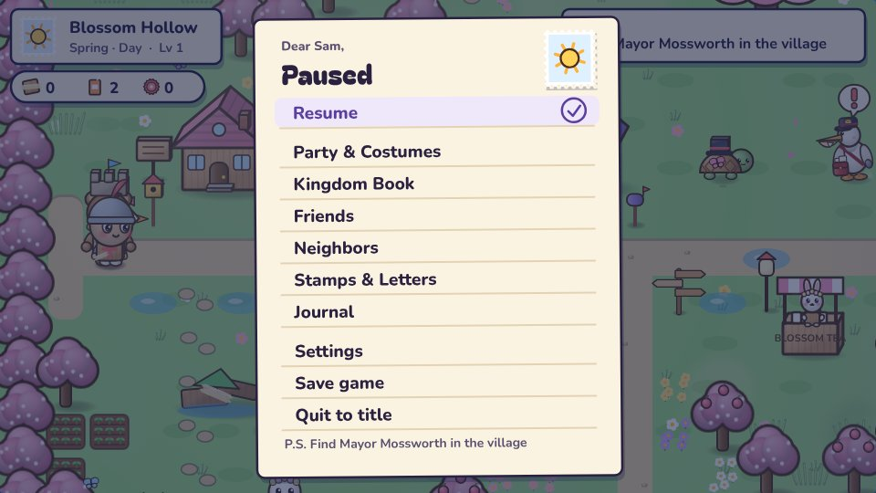
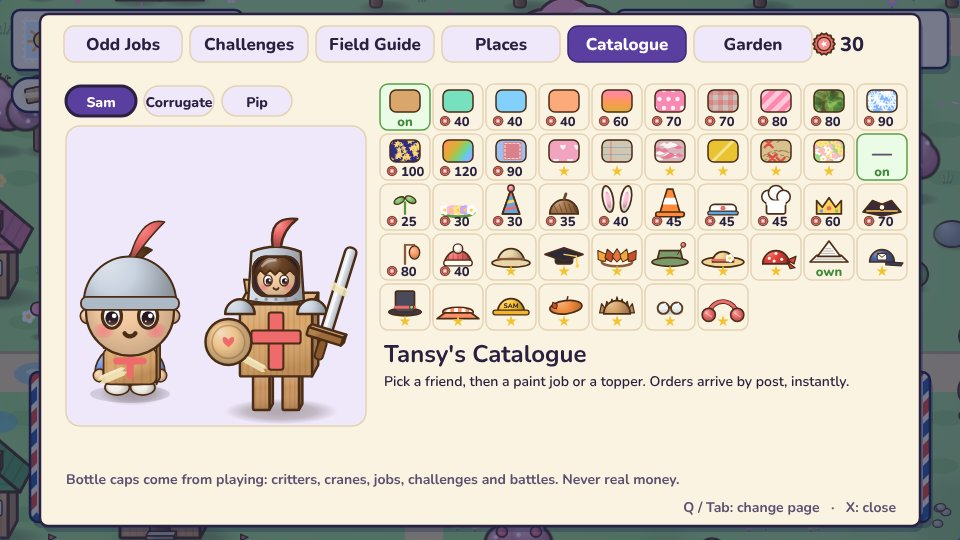
