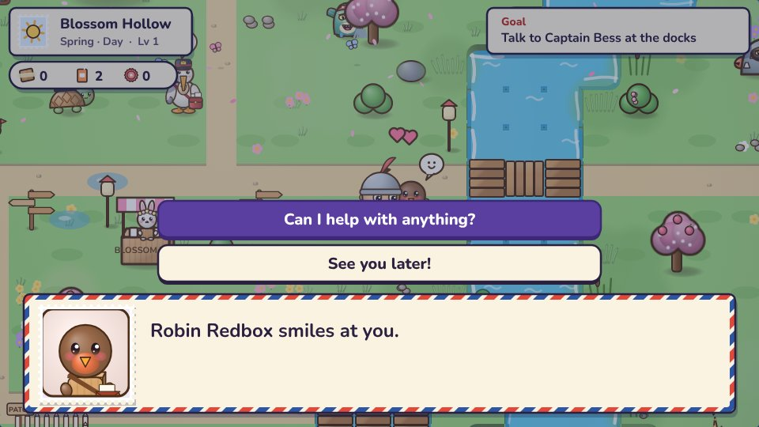
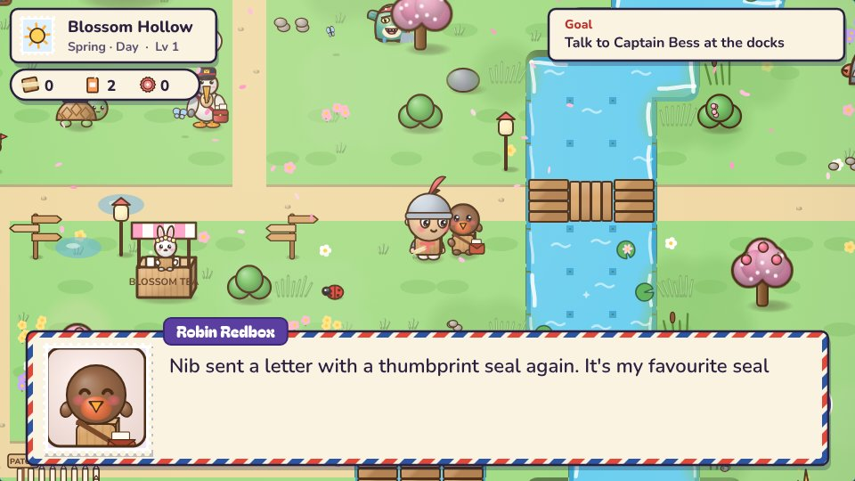
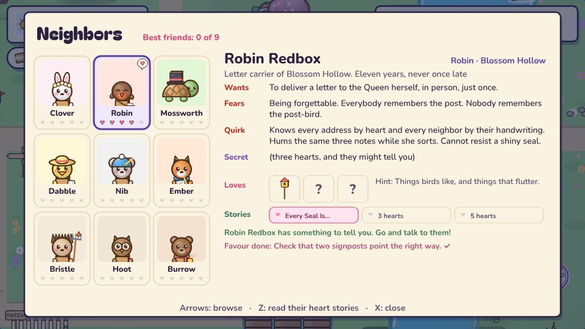
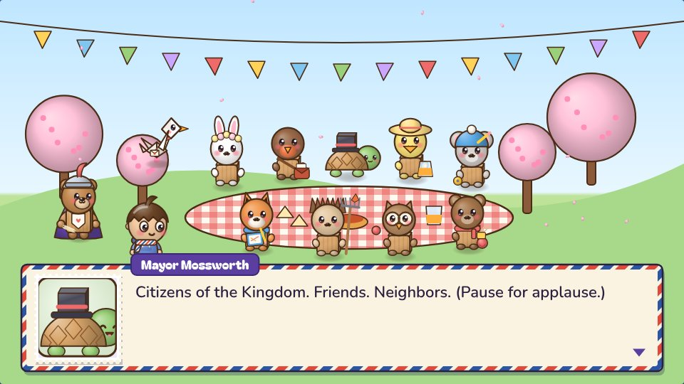
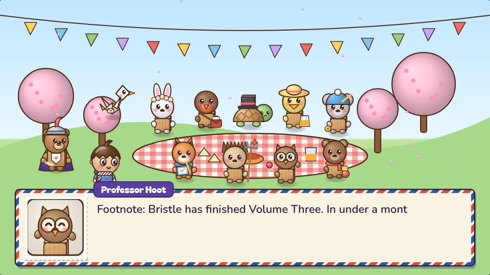
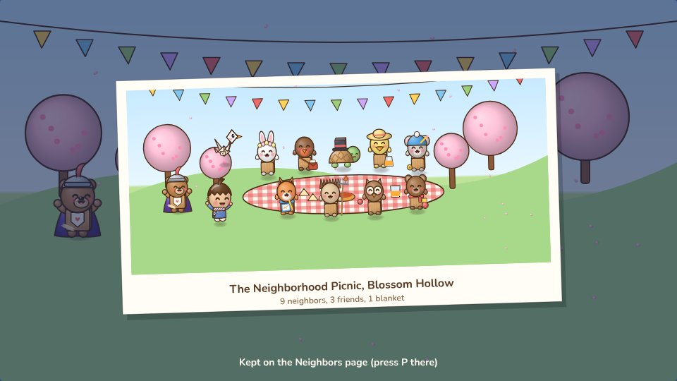
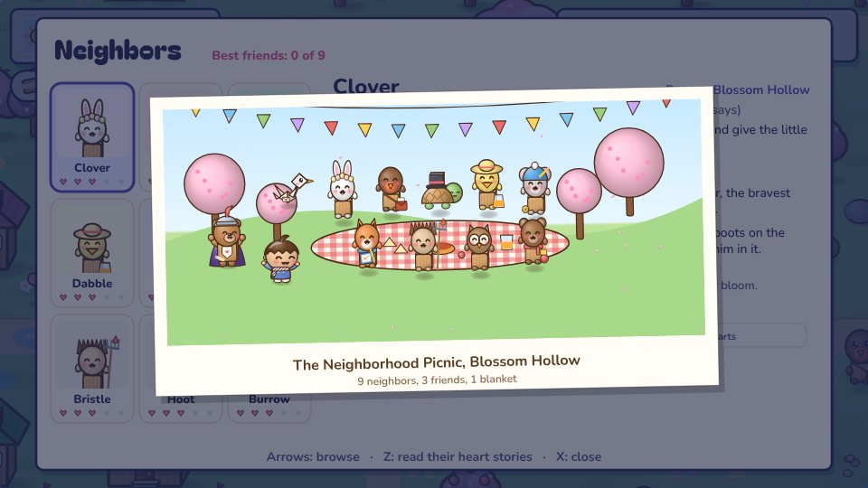
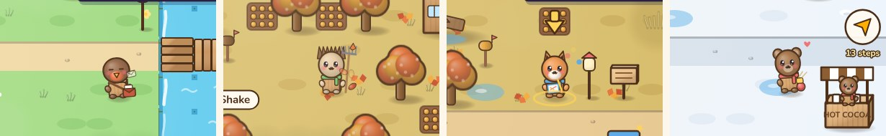
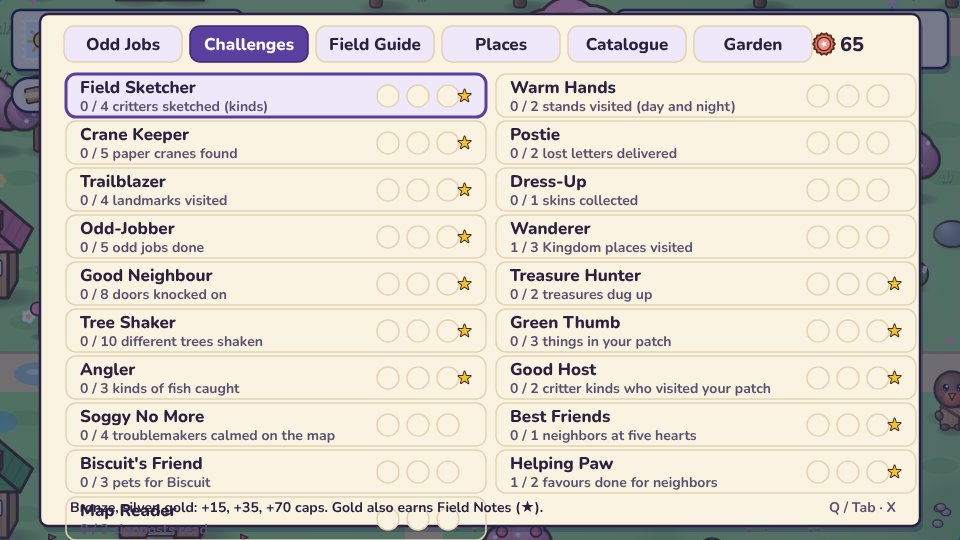

# v2.25: a Kingdom that lives together

 &nbsp;[Play 2.25.0](https://normansrule.github.io/cardboard-kingdom/versions.html#v2.25.0) · [Play the newest](https://normansrule.github.io/cardboard-kingdom/play.html)

Alek said "continue": keep making the characters cuter and people you care about, with deeper world-building and more to do. 2.24 made nine villagers into friends. This round makes them a community.

**1. Favours.** After their first heart story, each neighbor asks for one small thing that sends you into another part of the game. Robin wants two signposts checked, because a sign pointing the wrong way once sent a whole letter to the wrong pond.

**2. The Neighborhood Picnic.** Once four neighbors have told you their three-heart stories, Mayor Mossworth offers to host. Everyone you've met comes, from every season, and they talk to each other rather than only to Sam.

It ends with a group photo, which you keep on the Neighbors page.

**3. Little lives.** From a distance, neighbors do their own thing: Robin sorts letters, Bristle rakes up leaves, Ember sketches in colour and Mama Burrow knits hearts.

**4. A new challenge.** Helping Paw, for favours, with the Helping Paws paint at gold.

