# How v2.9 "Patchwork Hall" was built

Every image here was captured straight from the game canvas while it was being built, in the order the work happened. Nothing is a mock-up.

**What this round adds** (from [DESIGN_DIRECTION.md](../../../DESIGN_DIRECTION.md), sections 2, 3 and 7): a recurring workshop hub called Patchwork Hall, two new friends who live there (Tansy, a dormouse costume maker, and Brindle, a badger carpenter), and a Postcard Wall that shows every place you've rebuilt, before and after.

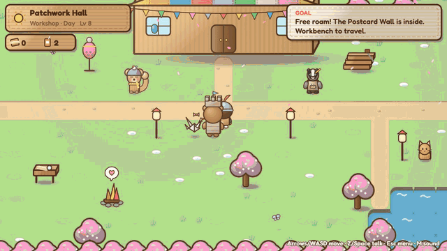

---

## 1. Before: where it fits

| Before | After |
|---|---|
| 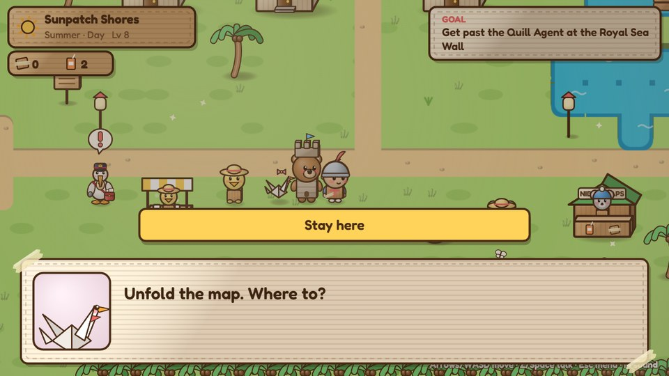 | 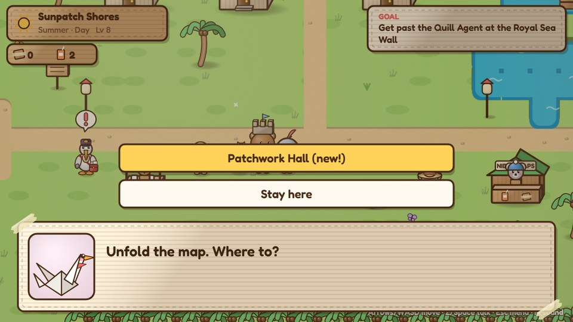 |
| The fold-out map (Workbench → travel) only lists story places. | Once Blossom Hollow is safe, **Patchwork Hall (new!)** appears. Late in the game the list gets long, so the choice box now switches to two columns when there are more than five options. |

## 2. Blockout

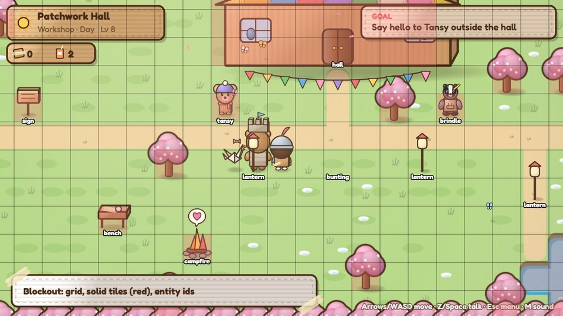

The map is laid out on the 48-pixel tile grid first. Red tiles are solid, and the labels are entity ids (hall, tansy, brindle, bench, campfire...). This is where I check that the door, the two friends and the workbench can all be reached from the start point.

## 3. First pass outside, and what was wrong with it

| First pass | Second pass |
|---|---|
| 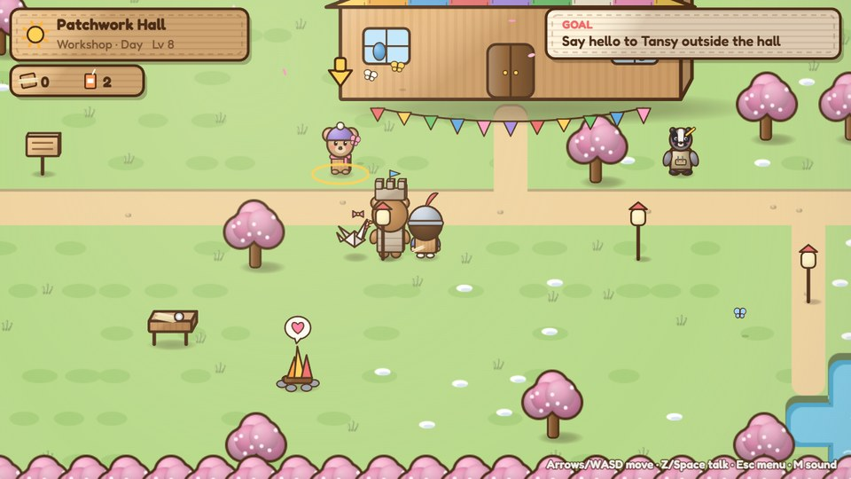 | 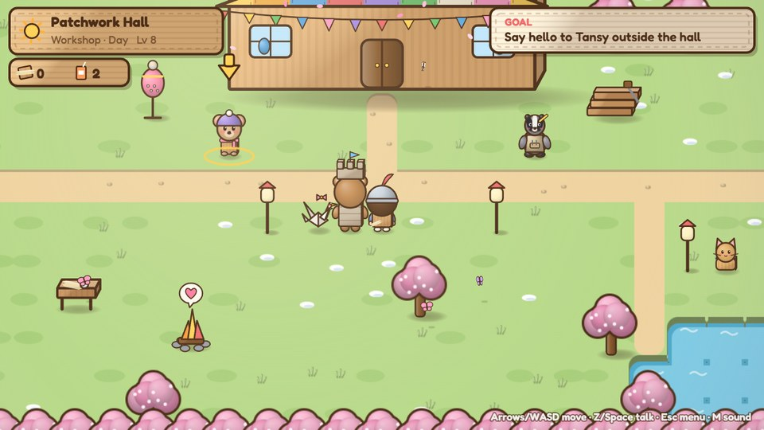 |
| The hall sat too close to the top edge of the map, so its quilted roof and sign were cut off, and the bunting hung over the path like a washing line. | The whole layout moved down two tiles. The bunting moved onto the hall's eaves, and two props tell you who works here: Tansy's dress form (left) and Brindle's lumber pile (right). |

## 4. Designing the two new friends

| First pass | Second pass |
|---|---|
| 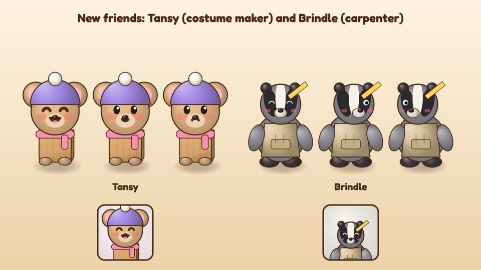 | 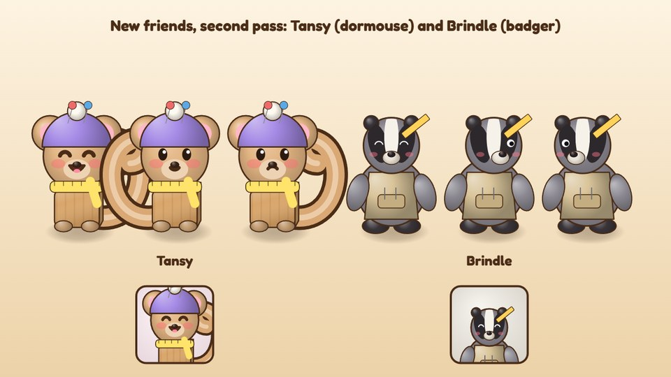 |
| Tansy reused the mouse critter with a beanie, and read as a small bear. Brindle (a new drawing: grey body, white stripe, black eye bands, canvas apron, pencil behind the ear) worked first time. | Tansy became her own look: a big fluffy dormouse tail, a measuring-tape scarf and two pins in her beanie. Three angles (front, right, left) plus the dialogue portrait are checked together. |

**Who they are.** Tansy helps Sam rediscover making things for fun rather than for a grade ("If you're only allowed to make good things, you stop making things"). Brindle shows that experience matters but familiar answers aren't always right (he is very confident about keystones). Both come straight from the design direction.

## 5. The hall interior

| First pass | Second pass | Final |
|---|---|---|
| 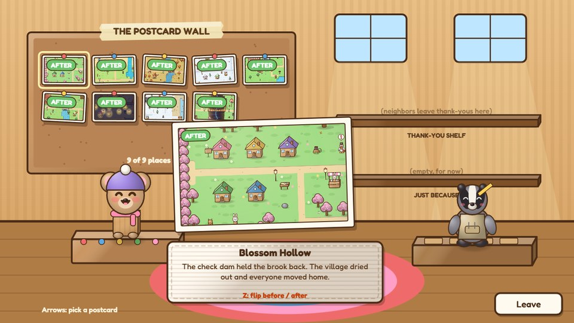 | 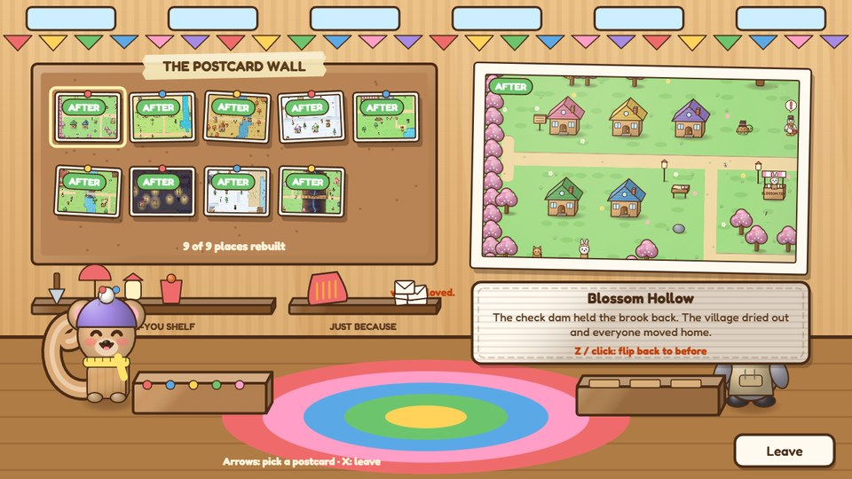 | 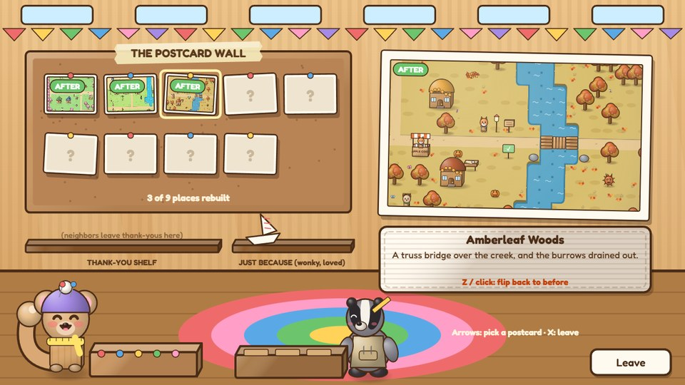 |
| Everything fought for the middle: the big postcard covered Tansy, Brindle disappeared behind the caption, and the shelves floated in the windows. | Layout split into zones. Postcard Wall on the left, the selected postcard held up large on the right, shelves under the wall, high windows and quilt bunting along the top. | Tansy and Brindle moved down to their tables on the floor, and the shelf labels and hints stopped overlapping. Thank-you gifts from Neighbor Round errands appear on the left shelf, your Just Because make on the right, and delivered letters stack at the end. |

## 6. The postcards are real before/after renders

| After | Flipping | Before |
|---|---|---|
| 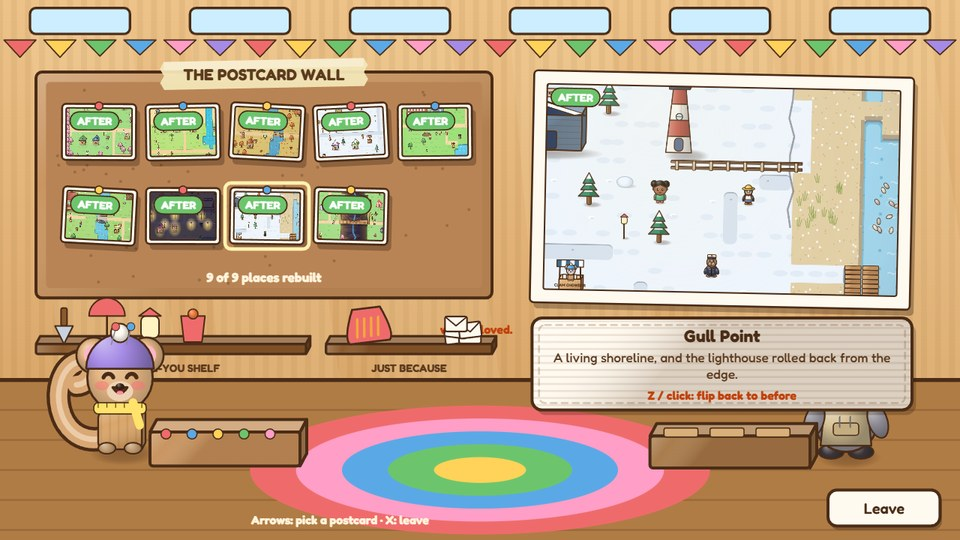 | 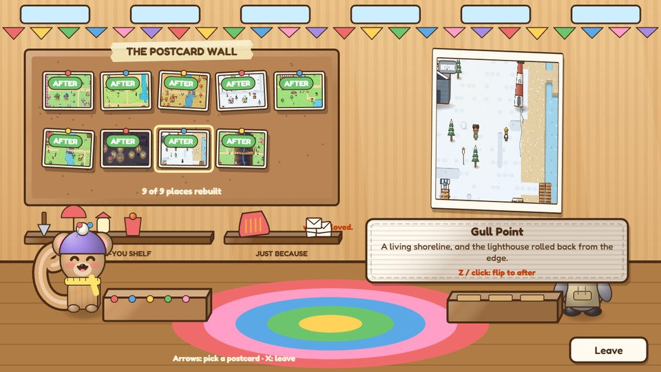 | 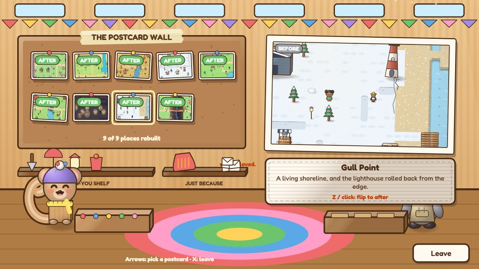 |

Each postcard is drawn by the game itself. A copy of that place's map is built with the story flags rolled back (before) or forward (after), the camera is pointed at the repair, and the frame is saved as a picture. Gull Point's lighthouse is right at the cliff edge before, and rolled back onto safe ground after. Press Z to flip a card; it squashes and turns like a real card.

## 7. Playing it

| | |
|---|---|
|  | 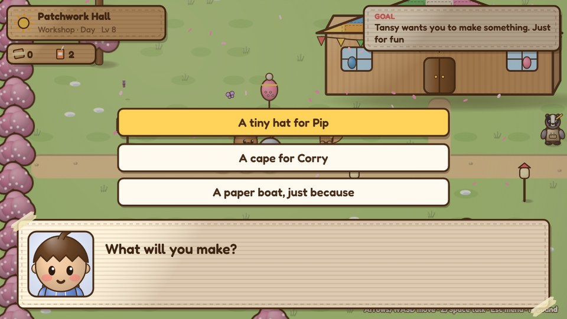 |
| Meeting Tansy: "I make costumes. Badly, mostly. Sometimes on purpose." | Tansy asks Sam to make something, not for a grade, just because. |
| 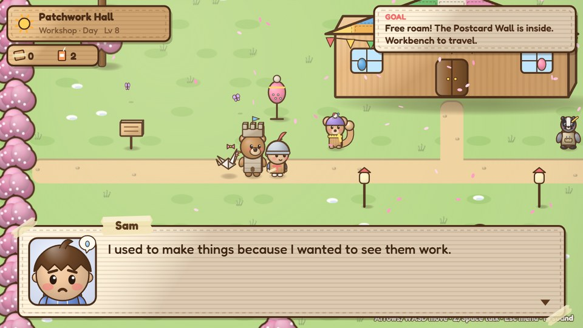 | 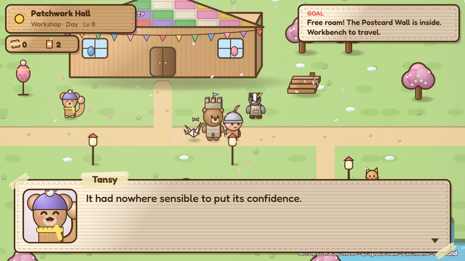 |
| The design direction's key line, in Sam's voice: "I used to make things because I wanted to see them work." | Brindle and the very confident keystone. "It had nowhere sensible to put its confidence." |

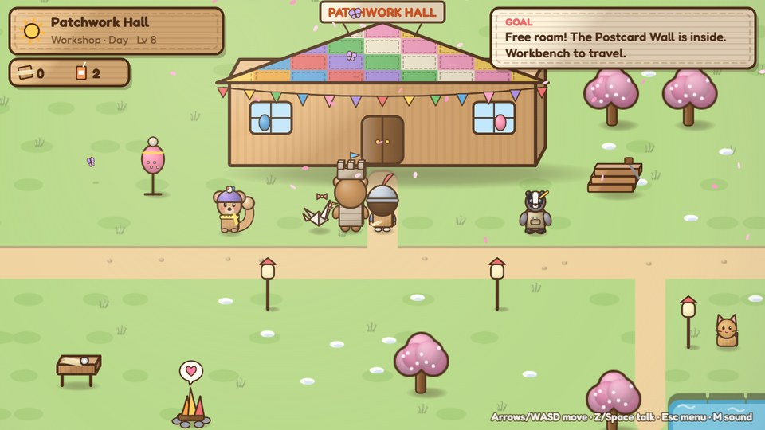

## Tools used

- `.claude/capture.js` drives the game headlessly (`CK.step`), paints frames on demand and posts them out of the browser, so every capture is the real game.
- Screenshots are saved as 960×540 JPGs; the GIF is 640×360 at 10 fps.
